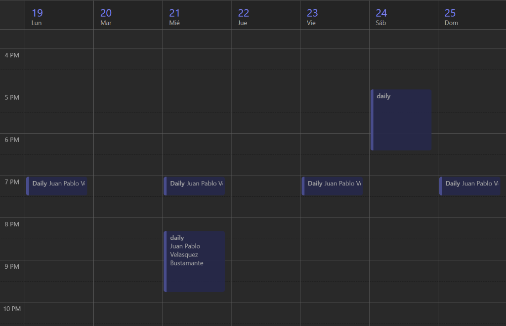
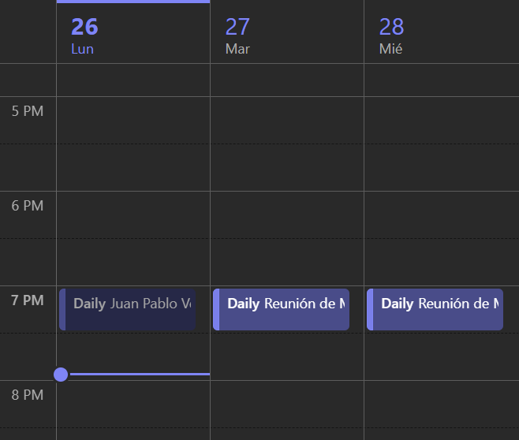
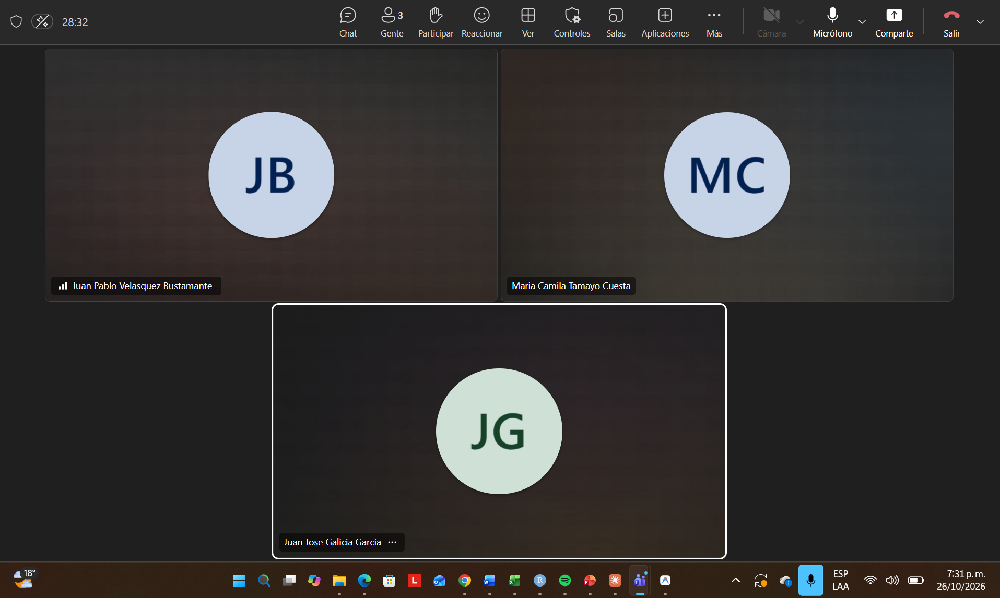

# Registro de Daily Scrum

Seguimiento y actas de las reuniones diarias del equipo Scrum.

---

## Programación y calendario de reuniones

Evidencia de las convocatorias y programación de los Daily Scrum del equipo en el calendario:

### Semana del 19 al 25 de octubre de 2026

### Semana del 26 al 28 de octubre de 2026

---

## Daily – 21/10/2026

Se usó la llamada para hablar de algunas correcciones con respecto al proyecto y se empezó a hablar de cómo se iban a distribuir las actividades para hacer el planning de los sprints y además aprovechamos para hablar del pitch de la clase.

---

## Daily – 24/10/2026

El día de hoy se usó el espacio para comentarnos de cómo van con las tareas que se habían asignado y para terminar de asignar algunas cosas que hacían falta.

---

## Daily – 26/10/2026

El día de hoy se usó para ver cómo iban todos con las historias de usuario asignadas.
