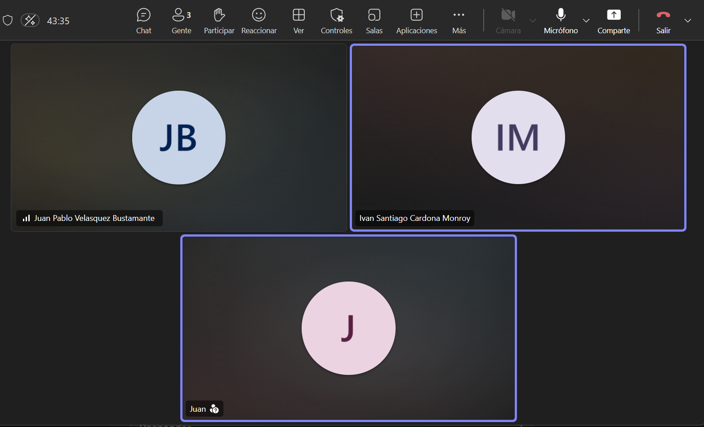
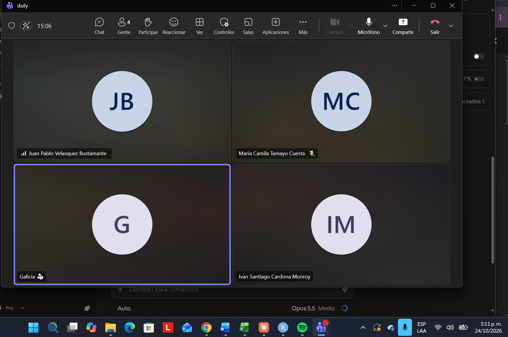

# Registro de Daily Scrum

Seguimiento y actas de las reuniones diarias del equipo Scrum.

---

## Daily – 21/10/2026

Se usó la llamada para hablar de algunas correcciones con respecto al proyecto y se empezó a hablar de cómo se iban a distribuir las actividades para hacer el planning de los sprints; además, aprovechamos para hablar del pitch de la clase.

---

## Daily – 24/10/2026

El día de hoy se usó el espacio para comentarnos de cómo van con las tareas que se habían asignado y para terminar de asignar algunas cosas que hacían falta.
