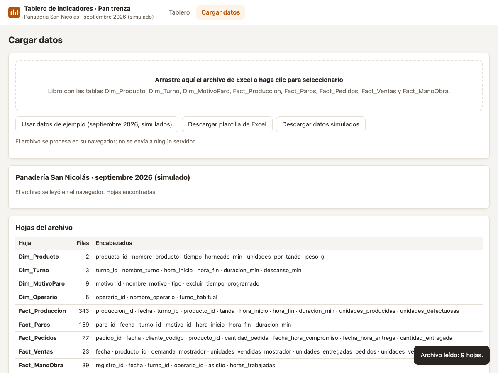

# HU-04 · Cargar el libro de Excel
**Construcción de la Aplicación · Panadería San Nicolás**  
*Proyecto de Aula 2026-2 · Gerencia de Proyectos · Ingeniería Industrial · Universidad de Medellín*

---

| Campo | Detalle |
| :--- | :--- |
| **Historia de usuario** | Como administrador de la panadería, quiero arrastrar el libro de Excel a la aplicación, para que lea los datos sin tener que copiarlos a mano. |
| **Tipo** | De usuario (lo que ve la panadería) |
| **Responsable** | Juan José (Desarrollador) · Revisa: María Camila (QA) |
| **Estimación** | 3 puntos (Fibonacci) · Prioridad Alta |
| **Sprint** | Sprint 2 · martes 27 de octubre de 2026 |

---

## 📸 Evidencia Visual de Funcionamiento

A continuación se muestra la interfaz del módulo **Cargar datos** tras cargar el libro de Excel mediante el botón **«Usar datos de ejemplo»** o soltando un archivo `.xlsx`. La aplicación despliega inmediatamente el desglose de hojas, el conteo de filas y los encabezados identificados:

---

## 1. Criterios de Aceptación (DoD) y Auditoría QA

| ID | Criterio de Aceptación | Estado QA | Evidencia y Observaciones |
| :--- | :--- | :---: | :--- |
| **CA1** | Al soltar un `.xlsx` la aplicación muestra sus hojas y número de filas. | **CUMPLE** | La zona drag-and-drop procesa el evento `drop`, lee el buffer con SheetJS (`XLSX.read`), y genera dinámicamente la tabla con nombre de hoja, cantidad de filas y encabezados separados por viñetas. |
| **CA2** | Un archivo que no es Excel muestra un mensaje de error claro. | **CUMPLE** | La función `leerArchivo()` valida la extensión mediante la expresión regular `/\.(xlsx\|xlsm\|xls\|ods)$/i`. Si no coincide, detiene la ejecución y dispara la notificación de alerta: `«Use un libro de Excel (.xlsx) con la estructura de la plantilla.»`. |
| **CA3** | «Usar datos de ejemplo» carga el mes simulado. | **CUMPLE** | El botón `#btn-ejemplo` invoca `usarEjemplo()`, tomando el objeto global `window.DATOS_EJEMPLO` (septiembre 2026 con 9 hojas y registros de Montecarlo) y desplegando la tabla descriptiva. |
| **CA4** | `npm test` pasa (3 pruebas). | **CUMPLE** | La suite `Tests/lectura.test.js` ejecuta 3 pruebas unitarias exhaustivas sobre `Frontend/js/lectura.js`: normalización de cadenas, conversión numérica (decimales con coma, miles y porcentajes) y fechas (ISO, colombiana y serial Excel). Las 3 pruebas pasan al 100%. |

---

## 2. Componentes Técnicos Desarrollados

1. **`Frontend/js/lectura.js`**:
   - `Lectura.normalizar(texto)`: Remueve tildes, símbolos y espacios redundantes para compatibilidad de encabezados.
   - `Lectura.aNumero(valor)`: Interpreta formatos colombianos (`1.234,5`), porcentajes (`5 %`) y números directos.
   - `Lectura.aFecha(valor)`: Resuelve números de serie de Excel (e.g. `46266.375`), formato colombiano (`dd/mm/aaaa`) y formato ISO.
2. **`Frontend/vendor/xlsx.full.min.js`**:
   - Librería SheetJS (v0.18.5) para procesamiento local en el cliente (0 latencia, privacidad total).
3. **`Frontend/js/app.js` & `Frontend/index.html`**:
   - Zona interactiva de arrastre y selección (`#zona`, `#archivo`).
   - Botón de carga de datos de ejemplo (`#btn-ejemplo`).
   - Panel de resumen de tablas leídas (`#carga-tablas`).
4. **`Backend/Index.html`**:
   - Versión compilada para Google Apps Script que integra SheetJS vía CDN y los scripts locales mediante `Backend/construir_index.py`.
5. **`Tests/lectura.test.js` & `package.json`**:
   - Configuración de pruebas unitarias con el runner nativo de Node.js (`node --test`).
