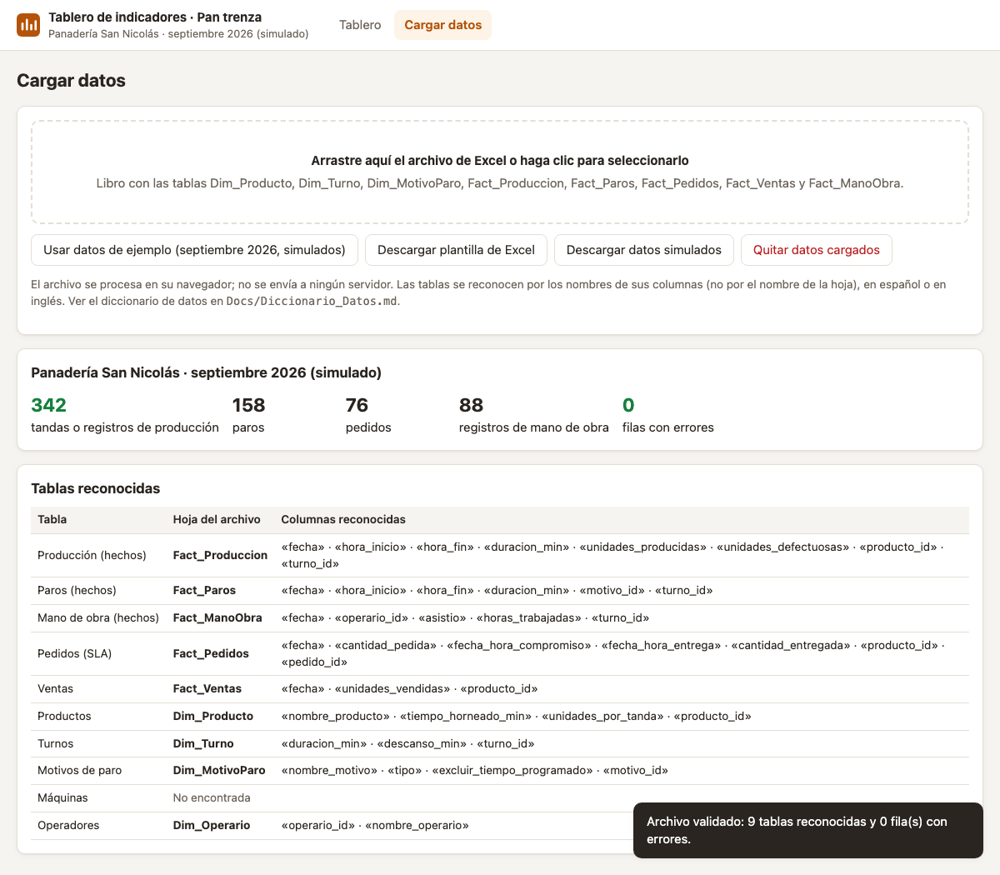

# HU-05 · Reconocer las tablas y validar los datos
**Construcción de la Aplicación · Panadería San Nicolás**  
*Proyecto de Aula 2026-2 · Gerencia de Proyectos · Ingeniería Industrial · Universidad de Medellín*

---

| Campo | Detalle |
| :--- | :--- |
| **Historia de usuario** | Como administrador de la panadería, quiero que la aplicación reconozca las tablas de mi archivo y me diga qué filas tienen errores, para estar seguro de que los indicadores se calculan con datos limpios y consistentes. |
| **Tipo** | De usuario (lo que ve la panadería) |
| **Responsable** | Iván Santiago (Desarrollador) · Revisa: María Camila (QA) |
| **Estimación** | 5 puntos (Fibonacci) · Prioridad Alta |
| **Sprint** | Sprint 2 · martes 27 de octubre de 2026 |

---

## 📸 Evidencia Visual de Funcionamiento

A continuación se muestra el módulo **Cargar datos** tras validar el libro de Excel. La aplicación analiza los encabezados de columna, identifica de forma agnóstica cada tabla del modelo relacional, cuantifica registros (342 tandas, 158 paros, 76 pedidos, 88 registros de mano de obra, 0 errores) y mapea las columnas reconocidas:

---

## 1. Criterios de Aceptación (DoD) y Auditoría QA

| ID | Criterio de Aceptación | Estado QA | Evidencia y Observaciones |
| :--- | :--- | :---: | :--- |
| **CA1** | Con el archivo de septiembre reconoce las 9 tablas y 0 filas con errores. | **CUMPLE** | Se validó el libro oficial de septiembre 2026 (`window.DATOS_EJEMPLO`). El motor `Modelo.construirModelo()` detectó exitosamente las 9 tablas relacionales (Fact_Produccion, Fact_Paros, Fact_Pedidos, Fact_Ventas, Fact_ManoObra, Dim_Producto, Dim_Turno, Dim_MotivoParo, Dim_Operario) y arrojó exactamente `0 filas con errores`. |
| **CA2** | Reconoce la base del curso aunque las hojas cambien de nombre. | **CUMPLE** | La función `Modelo.detectarTablas()` opera mediante coincidencia y puntuación de columnas normalizadas (sin importar si la hoja se llama `Hoja1`, `Sheet2` o en inglés/español). La prueba unitaria con hojas renombradas pasó al 100%. |
| **CA3** | Una tanda con defectuosas mayores que producidas aparece rechazada con su número de fila. | **CUMPLE** | Al inyectar una fila de prueba con unidades defectuosas (99) superiores a las producidas (16), el validador rechaza la tanda, captura la hoja `Fact_Produccion`, la fila correspondiente (fila 2) y el mensaje explícito: `«las defectuosas superan a las producidas»`. |
| **CA4** | `npm test` pasa (`Tests/modelo.test.js`). | **CUMPLE** | La suite en `Tests/modelo.test.js` contiene 6 pruebas unitarias integradas (reconocimiento de tablas, independencia de nombres de hoja, exclusión de libros no relacionales, consistencia de septiembre, cálculo de tiempo ideal de trenza y validación de reglas de integridad). Todas pasaron al 100%. |

---

## 2. Componentes Técnicos Desarrollados

1. **`Frontend/js/modelo.js`**:
   - `Modelo.detectarTablas(hojas)`: Identificador de entidades por coincidencia de columnas requeridas y opcionales.
   - `Modelo.construirModelo(hojas)`: Construcción del modelo relacional validado en memoria, limpieza de tipos con `Lectura`, indexación de dimensiones y captura de lista estructurada de errores (`errores: [{hoja, fila, mensaje}]`).
   - Normalización de tiempos ideales de horneado (1.375 min/unidad para trenza de 350 g).
2. **`Frontend/index.html` & `Frontend/js/app.js`**:
   - Visualización de tarjetas de estado de carga (`#carga-estado`) con contadores de producción, paros, pedidos, mano de obra y errores.
   - Tabla de mapeo conceptual a físico (`#carga-tablas`).
   - Panel desplegable de errores y advertencias (`#carga-errores-panel`).
   - Botón interactivo para descartar datos (`#btn-borrar`).
3. **`Backend/Index.html`**:
   - Compilado generado con `Backend/construir_index.py` integrando `modelo.js`.
4. **`Tests/modelo.test.js`, `Tests/comun.js` & `Tests/datos-base-oee-curso.js`**:
   - Casos de prueba exhaustivos para verificación continua.
