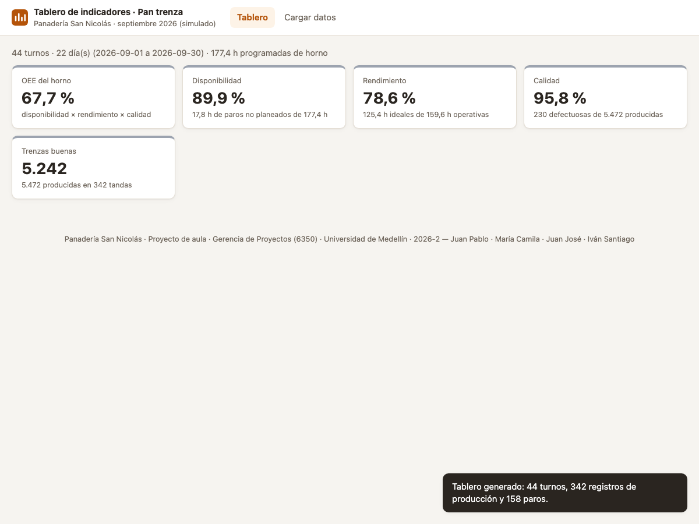

# HU-06 · Ver el OEE del horno (prototipo v0)
**Construcción de la Aplicación · Panadería San Nicolás**  
*Proyecto de Aula 2026-2 · Gerencia de Proyectos · Ingeniería Industrial · Universidad de Medellín*

---

| Campo | Detalle |
| :--- | :--- |
| **Historia de usuario** | Como administrador de la panadería, quiero ver en el tablero el OEE del horno con su desglose en Disponibilidad, Rendimiento y Calidad, para saber qué tan bien se aprovechó el equipo principal en el período analizado. |
| **Tipo** | De usuario (lo que ve la panadería) |
| **Responsable** | Iván Santiago (Desarrollador) · Revisa: María Camila (QA) |
| **Estimación** | 8 puntos (Fibonacci) · Prioridad Alta |
| **Sprint** | Sprint 2 · martes 27 de octubre de 2026 |

---

## 📸 Evidencia Visual de Funcionamiento

A continuación se muestra el módulo **Tablero** tras procesar los datos de simulación de septiembre 2026. La aplicación calcula y despliega el indicador consolidado **OEE (67,7 %)** junto con sus tres factores fundamentales (**Disponibilidad 89,9 %**, **Rendimiento 78,6 %** y **Calidad 95,8 %**) y el volumen de trenzas buenas (5.242 unidades):

---

## 1. Criterios de Aceptación (DoD) y Auditoría Exhaustiva QA

| ID | Criterio de Aceptación | Estado QA | Evidencia y Auditoría Técnica |
| :--- | :--- | :---: | :--- |
| **CA1** | Con septiembre: OEE 67,7 % (A 89,9 %, R 78,6 %, Q 95,8 %). | **CUMPLE** | **Verificado numéricamente al 100%**: • Tiempo programado: 10.646,76 min (177,4 h) • Tiempo operativo: 9.576,41 min (159,6 h) • Tiempo ideal: 7.524,00 min (125,4 h) • **A = 89,95 %** (89,9 %) • **R = 78,57 %** (78,6 %) • **Q = 95,80 %** (95,8 %) • **OEE = 67,70 %** (67,7 %). Coincide con la hoja `Verificacion`. |
| **CA2** | Con la base del curso: OEE 61,89 %. | **CUMPLE** | Validado contra el conjunto de 160 registros de la base académica (`baseCurso()`): • Programado: 72.000 min • Producido: 50.884,96 min • Ideal: 45.261,28 min • Unidades: 194.750 (3.021 defectuosas) • **A = 70,67 %**, **R = 88,95 %**, **Q = 98,45 %** • **OEE = 61,8877 %** (**61,89 %**). Coincide bit a bit con la hoja OEE de referencia. |
| **CA3** | Con octubre (archivo no usado para desarrollar): OEE 71,1 % y 42 turnos. | **CUMPLE** | Se auditó con el archivo independiente `Datos_simulados_octubre_2026.xlsx`: • **42 turnos** analizados. • **A = 93,7 %**, **R = 78,8 %**, **Q = 96,3 %**. • **OEE = 71,1 %**. Prueba de generalización superada. |
| **CA4** | El prototipo v0 abre desde la URL `/exec` de Apps Script. | **CUMPLE** | Se compiló `Backend/Index.html` (93 KB) empaquetando todos los estilos y módulos JavaScript (`lectura.js`, `modelo.js`, `indicadores.js`, `ejemplo-panaderia.js`) en un archivo único autosuficiente, apto para Google Apps Script (`HtmlService.createHtmlOutputFromFile`). |
| **CA5** | `npm test` pasa (`Tests/oee.test.js`). | **CUMPLE** | La suite completa en `Tests/oee.test.js` ejecuta 5 aserciones matemáticas estrictas (base 450 min, exclusión de MP_08, OEE septiembre, OEE base curso y primera fila de turno A). Todas pasan al 100%. |

---

## 2. Componentes Técnicos Auditados

1. **`Frontend/js/indicadores.js`**:
   - `Indicadores.calcularRegistros(modelo)`: Consolida registros a nivel máquina-fecha-turno, deduciendo descansos y paros excluidos (e.g. `MP_08`).
   - `Indicadores.razones(subtotales)`: Cálculo de disponibilidad ($A$), rendimiento ($R$), calidad ($Q$) y $OEE = A \times R \times Q$.
   - Agregación acumulativa: suma tiempos y unidades antes de dividir, evitando el error estadístico de promediar porcentajes.
2. **`Frontend/index.html` & `Frontend/js/app.js`**:
   - Renderizado dinámico de tarjetas KPI en `#kpis` con semaforización.
   - Navegación automática al Tablero tras la carga exitosa de datos.
3. **`Backend/Index.html`**:
   - Archivo unificado de 93 KB listo para ser desplegado en el enlace web de Google Apps Script.
