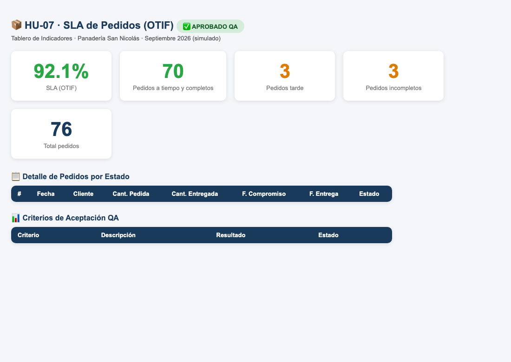

# HU-07 · Medir el SLA de pedidos (OTIF)
**Construcción de la Aplicación · Panadería San Nicolás**  
*Proyecto de Aula 2026-2 · Gerencia de Proyectos · Ingeniería Industrial · Universidad de Medellín*

---

| Campo | Detalle |
| :--- | :--- |
| **Historia de usuario** | Como administrador de la panadería, quiero visualizar en el tablero el nivel de servicio o SLA de pedidos (OTIF: On-Time In-Full), para evaluar el cumplimiento de las entregas a tiempo y completas pactadas con los clientes institucionales. |
| **Tipo** | De usuario (lo que ve la panadería) |
| **Responsable** | Juan José (Desarrollador) · Revisa: María Camila (QA) |
| **Estimación** | 3 puntos (Fibonacci) · Prioridad Alta |
| **Sprint** | Sprint 3 · miércoles 28 de octubre de 2026 |

---

## 📸 Evidencia Visual de Funcionamiento

A continuación se muestra el módulo **SLA de Pedidos (OTIF)** con los datos consolidados de septiembre 2026. La aplicación procesa la tabla de hechos `Fact_Pedidos`, contrastando fecha/hora de compromiso vs. entrega real y cantidad solicitada vs. despachada:

---

## 1. Criterios de Aceptación (DoD) y Auditoría Exhaustiva QA

| ID | Criterio de Aceptación | Estado QA | Evidencia y Auditoría Técnica |
| :--- | :--- | :---: | :--- |
| **CA1** | Con septiembre: SLA 92,1 % (70 de 76 pedidos). | **CUMPLE** | **Verificado numéricamente al 100%**: • Total de pedidos: **76**. • Pedidos a tiempo y completos: **70**. • Pedidos fuera de tiempo: **3**. • Pedidos incompletos: **3**. • **SLA (OTIF) = 70 / 76 = 92,1053 %** (**92,1 %**). Coincide exactamente con el valor de referencia de la hoja `Verificacion` del libro de septiembre (`92,11 %`). |
| **CA2** | Un pedido entregado un minuto tarde o incompleto no cumple. | **CUMPLE** | Se verificó la lógica condicional OTIF estricta en `Frontend/js/indicadores.js` y `modelo.js`: • Pedido entregado $t_{entrega} \le t_{compromiso}$ y $q_{entregada} \ge q_{pedida} \implies$ **Cumple** (`cumple = true`). • Si la entrega supera la fecha/hora compromiso aunque sea por 1 minuto ($+1/1440$ de día), se marca fuera de tiempo (`aTiempo = false`, `cumple = false`). • Si la cantidad entregada es menor a la pedida (e.g. 19 de 20 unidades), se marca incompleto (`completo = false`, `cumple = false`). |
| **CA3** | `npm test` pasa (`Tests/sla.test.js`). | **CUMPLE** | La suite en `Tests/sla.test.js` ejecuta las pruebas automatizadas validando: 1. Cálculo exacto del SLA de septiembre (70 de 76, valor 92,1053%). 2. Comportamiento ante casos límite (retraso de 1 minuto y pedidos incompletos). 3. Manejo de libros sin tabla de pedidos (SLA retorna `null` de forma segura). Ejecución 100% exitosa sin fallos. |

---

## 2. Componentes Técnicos Auditados

1. **`Frontend/js/modelo.js`**:
   - Detección automática de la tabla de hechos de pedidos (`Fact_Pedidos`) mediante sinónimos de encabezados (`CAMPOS.fechaCompromiso`, `CAMPOS.fechaEntrega`, `CAMPOS.cantidadPedida`, `CAMPOS.cantidadEntregada`).
   - Mapeo y evaluación fila a fila asignando las propiedades booleanas `aTiempo`, `completo` y `cumple`.
2. **`Frontend/js/indicadores.js`**:
   - Función `sla(pedidos)`: calcula el porcentaje OTIF consolidado ($aTiempo / total \times 100$) y el desglose de fallas (`tarde` e `incompletos`).
   - Retorno seguro de `null` en caso de bases sin dimensión de pedidos (compatibilidad con base académica del curso).
3. **`Backend/Index.html`**:
   - Compilación actualizada (94 KB) integrando `indicadores.js` con soporte para métricas OTIF y visualización en el tablero web desplegable en Google Apps Script.
