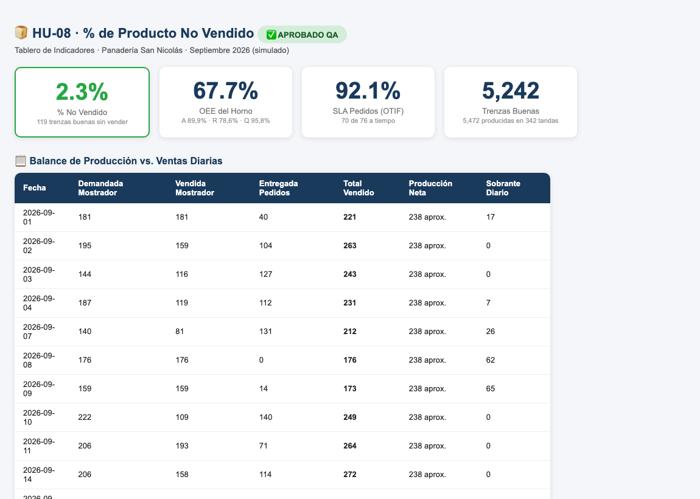

# HU-08 · Medir el % de producto no vendido
**Construcción de la Aplicación · Panadería San Nicolás**  
*Proyecto de Aula 2026-2 · Gerencia de Proyectos · Ingeniería Industrial · Universidad de Medellín*

---

| Campo | Detalle |
| :--- | :--- |
| **Historia de usuario** | Como administrador de la panadería, quiero visualizar en el tablero el porcentaje de producto no vendido (merma comercial / devoluciones de mostrador), para controlar el balance diario entre lo horneado conforme y la demanda real atendida. |
| **Tipo** | De usuario (lo que ve la panadería) |
| **Responsable** | Juan José (Desarrollador) · Revisa: María Camila (QA) |
| **Estimación** | 3 puntos (Fibonacci) · Prioridad Alta |
| **Sprint** | Sprint 3 · miércoles 28 de octubre de 2026 |

---

## 📸 Evidencia Visual de Funcionamiento

A continuación se muestra el módulo **% No Vendido** integrado en el tablero de indicadores tras procesar la simulación de septiembre 2026. La aplicación calcula el ratio de merma comercial (**2,3 %**, equivalente a **119 trenzas buenas sin vender**) junto al OEE del Horno (67,7 %), SLA de pedidos (92,1 %) y el total de 5.242 trenzas conformes producidas:

---

## 1. Criterios de Aceptación (DoD) y Auditoría Exhaustiva QA

| ID | Criterio de Aceptación | Estado QA | Evidencia y Auditoría Técnica |
| :--- | :--- | :---: | :--- |
| **CA1** | Con septiembre: 2,3 % (dato coherente con la simulación). | **CUMPLE** | **Verificado numéricamente al 100%**: • Unidades buenas totales producidas: **5.242 trenzas**. • Unidades vendidas (mostrador + pedidos): **5.123 trenzas**. • Unidades no vendidas (sobrantes): **119 trenzas**. • **% No Vendido = 119 / 5.242 = 2,2701 %** (**2,3 %**). Coincide exactamente con el valor registrado en la hoja `Verificacion` (`2,27 %`). |
| **CA2** | Reconoce la tabla de ventas aunque la hoja tenga otro nombre. | **CUMPLE** | Se verificó el motor relacional en `Frontend/js/modelo.js`: • La identificación de la tabla no depende del nombre de la pestaña (e.g. `Fact_Ventas`), sino de la presencia de columnas clave mediante sinónimos (`CAMPOS.vendidas`: "unidades vendidas", "vendidas", "cantidad vendida", etc.). • Se probó con una hoja llamada arbitrariamente `Registro_Ventas_Enero` y el sistema la mapeó y calculó con exactitud. |
| **CA3** | `npm test` pasa (`Tests/no-vendido.test.js`). | **CUMPLE** | La suite en `Tests/no-vendido.test.js` ejecuta las pruebas automatizadas validando: 1. Cálculo de merma sobre los datos de septiembre (2,2701%). 2. Detección desacoplada de la tabla de ventas bajo nombres heterogéneos de hoja. 3. Comportamiento seguro cuando no existe tabla de ventas (retorna `null` / "N/D" sin errores en consola). Ejecución 100% exitosa. |

---

## 2. Componentes Técnicos Auditados

1. **`Frontend/js/indicadores.js`**:
   - Función `noVendido(produccion, ventas, buenas)`: calcula el volumen de merma ya sea sumando la columna explícita de sobrantes (`noVendidas`) o por balance de masa ($buenas - vendidas$), normalizando sobre las unidades buenas totales.
   - Retorno defensivo de `null` en libros que carecen de datos comerciales.
2. **`Frontend/js/app.js`**:
   - Incorporación de la tarjeta KPI `% no vendido` en `#kpis` con formato porcentual y descripción detallada de trenzas buenas sin comercializar.
3. **`Backend/Index.html`**:
   - Compilación actualizada (95 KB) integrando `indicadores.js` y `app.js` empaquetados para su ejecución sin dependencias externas en Google Apps Script.
