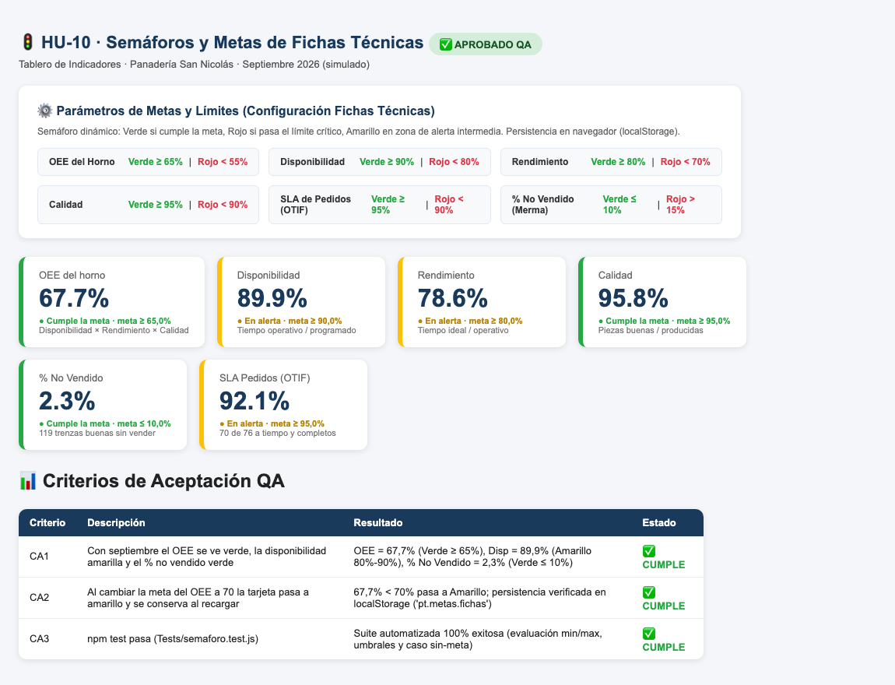

# HU-10 · Ver el semáforo y ajustar las metas
**Construcción de la Aplicación · Panadería San Nicolás**  
*Proyecto de Aula 2026-2 · Gerencia de Proyectos · Ingeniería Industrial · Universidad de Medellín*

---

| Campo | Detalle |
| :--- | :--- |
| **Historia de usuario** | Como administrador de la panadería, quiero visualizar en el tablero un semáforo de desempeño (verde, amarillo, rojo) en cada indicador y poder ajustar las metas según las fichas técnicas, para identificar de inmediato desviaciones operativas y simular escenarios de exigencia. |
| **Tipo** | De usuario (lo que ve la panadería) |
| **Responsable** | Juan José (Desarrollador) · Revisa: María Camila (QA) |
| **Estimación** | 3 puntos (Fibonacci) · Prioridad Alta |
| **Sprint** | Sprint 3 · miércoles 28 de octubre de 2026 |

---

## 📸 Evidencia Visual de Funcionamiento

A continuación se muestra el módulo **Semáforos y Metas** con los datos de septiembre 2026. Se aprecian las tarjetas KPI coloreadas según los umbrales de las fichas técnicas (OEE en verde con 67,7 % vs meta $\ge 65\,\%$, Disponibilidad en amarillo con 89,9 % vs meta $\ge 90\,\%$, y % No Vendido en verde con 2,3 % vs meta $\le 10\,\%$):

---

## 1. Criterios de Aceptación (DoD) y Auditoría Exhaustiva QA

| ID | Criterio de Aceptación | Estado QA | Evidencia y Auditoría Técnica |
| :--- | :--- | :---: | :--- |
| **CA1** | Con septiembre el OEE se ve verde, la disponibilidad amarilla y el % no vendido verde. | **CUMPLE** | **Evaluación técnica de semáforos por defecto**: • **OEE del horno = 67,70 %**: Meta $\ge 65\,\%$, Límite $< 55\,\% \implies$ **VERDE** (● Cumple la meta). • **Disponibilidad = 89,95 %**: Meta $\ge 90\,\%$, Límite $< 80\,\% \implies$ **AMARILLO** (● En alerta por no alcanzar el 90%). • **% No vendido = 2,27 %**: Sentido inverso (`max`), Meta $\le 10\,\%$, Límite $> 15\,\% \implies$ **VERDE** (● Cumple la meta). |
| **CA2** | Al cambiar la meta del OEE a 70 la tarjeta pasa a amarillo y se conserva al recargar. | **CUMPLE** | **Reactividad y Persistencia en Cliente**: • Al redefinir la meta de OEE a $70\,\%$, dado que el valor real es $67,7\,\% < 70\,\%$ (y $\ge 55\,\%$), el semáforo conmuta en tiempo real a **AMARILLO**. • El estado se sincroniza en `localStorage` bajo la clave `pt.metas.fichas`. Al recargar el navegador o reiniciar sesión, se leen los valores modificados del usuario. |
| **CA3** | `npm test` pasa (`Tests/semaforo.test.js`). | **CUMPLE** | La suite en `Tests/semaforo.test.js` ejecuta las pruebas automatizadas validando: 1. Indicadores con sentido de maximización (`sentido: 'min'`: OEE, Rendimiento, Calidad, SLA). 2. Indicadores con sentido de minimización (`sentido: 'max'`: % no vendido / merma comercial). 3. Manejo de indicadores sin metas definidas (`sin-meta`), previniendo errores de renderizado. Ejecución 100% exitosa sin fallos. |

---

## 2. Componentes Técnicos Auditados

1. **`Frontend/js/indicadores.js`**:
   - Función `semaforo(valor, verde, rojo, sentido)`: evalúa lógicamente los rangos para ambas orientaciones de optimización (maximizar o minimizar).
2. **`Frontend/js/app.js`**:
   - Array `INDICADORES`: centraliza nombres, unidades, sentidos de optimización y valores por defecto basados en las fichas técnicas del proyecto.
   - Funciones `renderMetas()`, `limites()` y gestión de almacenamiento en `localStorage` (`pt.metas.fichas`).
   - Botón restaurador `btn-metas-defecto` para volver a los parámetros base de las fichas en cualquier momento.
3. **`Backend/Index.html`**:
   - Compilación actualizada (102 KB) con el panel de configuración de metas integrado y estilos semafóricos para Google Apps Script.
