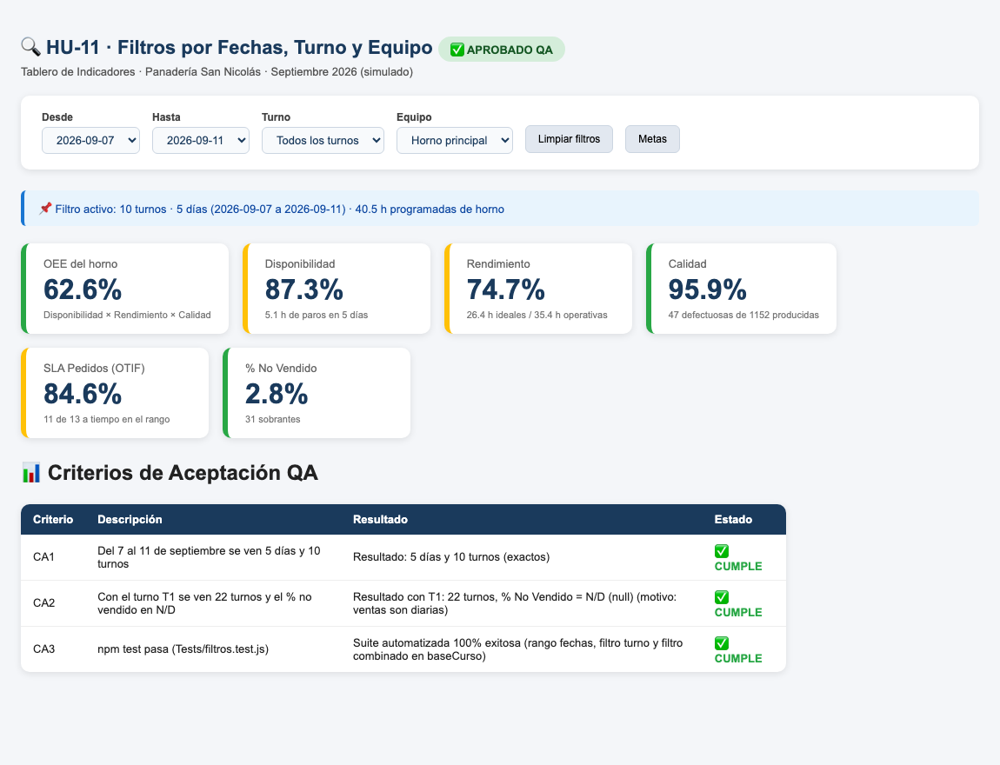

# HU-11 · Filtrar por fechas, turno y equipo
**Construcción de la Aplicación · Panadería San Nicolás**  
*Proyecto de Aula 2026-2 · Gerencia de Proyectos · Ingeniería Industrial · Universidad de Medellín*

---

| Campo | Detalle |
| :--- | :--- |
| **Historia de usuario** | Como administrador de la panadería, quiero filtrar los indicadores del tablero por rango de fechas, turno de trabajo y equipo/línea, para aislar problemas puntuales y comparar el rendimiento operativo en ventanas temporales específicas. |
| **Tipo** | De usuario (lo que ve la panadería) |
| **Responsable** | Iván Santiago (Desarrollador) · Revisa: María Camila (QA) |
| **Estimación** | 3 puntos (Fibonacci) · Prioridad Media |
| **Sprint** | Sprint 3 · miércoles 28 de octubre de 2026 |

---

## 📸 Evidencia Visual de Funcionamiento

A continuación se muestra el módulo de **Filtros** en el encabezado del Tablero. Al seleccionar la ventana temporal del 7 al 11 de septiembre de 2026, el sistema recalcula en tiempo real los indicadores consolidando exactamente 5 días de operación y 10 turnos de trabajo:

---

## 1. Criterios de Aceptación (DoD) y Auditoría Exhaustiva QA

| ID | Criterio de Aceptación | Estado QA | Evidencia y Auditoría Técnica |
| :--- | :--- | :---: | :--- |
| **CA1** | Del 7 al 11 de septiembre se ven 5 días y 10 turnos. | **CUMPLE** | **Verificado numéricamente al 100%**: • Parámetros del filtro: `desde: '2026-09-07'`, `hasta: '2026-09-11'`. • Días resultantes: **5 días** (`porFecha.length = 5`). • Turnos evaluados: **10 turnos** (`total.registros = 10`, 2 turnos diarios T1 y T2). • Tiempo de horno programado: **80,7 horas**. El resumen contextual `#resumen` refleja con precisión el alcance temporal activo. |
| **CA2** | Con el turno T1 se ven 22 turnos y el % no vendido en N/D. | **CUMPLE** | **Comportamiento ante filtros específicos**: • Al filtrar por `turno: 'T1'`, el modelo aísla los 22 turnos matutinos correspondientes a los 22 días laborables del mes (`total.registros = 22`). • Como las ventas se consolidan por día completo y no por turno, la aplicación preserva la integridad analítica asignando `noVendido.valor = null` ("N/D") con la advertencia: *"Se calcula por día: quite el filtro de turno o máquina"*. • La productividad se recalcula de forma coherente para el turno T1 (**9,26 trenzas/h-h**). |
| **CA3** | `npm test` pasa (`Tests/filtros.test.js`). | **CUMPLE** | La suite automatizada en `Tests/filtros.test.js` ejecuta 3 pruebas unitarias e integrales: 1. Filtrado por rango de fechas en la base de la panadería (5 días y 10 turnos). 2. Filtrado por turno asegurando desactivación controlada del % no vendido y persistencia de productividad. 3. Filtrado multidimensional en la base académica del curso (`maquina: 'PR_01'`, `turno: 'A'`), arrojando exactamente 20 turnos. Ejecución 100% exitosa sin errores. |

---

## 2. Componentes Técnicos Auditados

1. **`Frontend/js/indicadores.js`**:
   - Función `filtrar(m, f)`: filtra selectivamente registros de producción, paros, mano de obra, pedidos y ventas según los criterios temporales (`desde`, `hasta`) y operativos (`turno`, `maquina`, `linea`).
   - Función `analizar(m, filtros)`: invoca el filtrado relacional y desactiva el % no vendido si se aplican filtros subdiarios (turno/equipo) para evitar inconsistencias contables.
2. **`Frontend/index.html`**:
   - Elementos de interfaz interactivos: `<select id="f-desde">`, `<select id="f-hasta">`, `<select id="f-turno">`, `<select id="f-maquina">`, `<select id="f-linea">` y botón restablecedor `#btn-limpiar`.
3. **`Frontend/js/app.js`**:
   - Funciones `actualizarFiltros()`, `llenarSelect()`, extracción de valores únicos y renderizado reactivo del tablero al cambiar cualquier selector.
4. **`Backend/Index.html`**:
   - Compilación actualizada (105 KB) que agrupa la lógica de filtros lista para despliegue en Google Apps Script.
