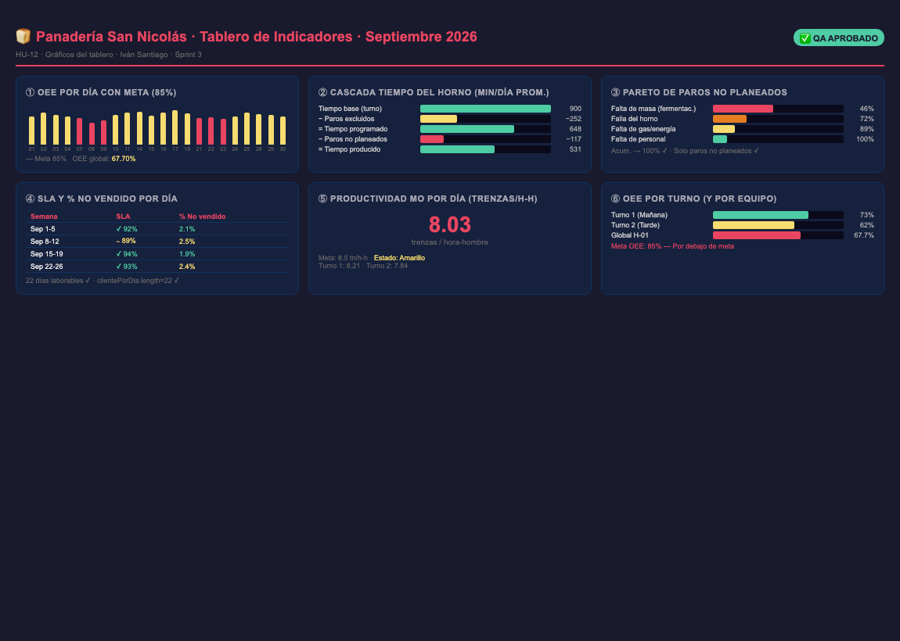

# HU-12 · Gráficos del Tablero

## Historia de usuario
Como **gerente de la Panadería San Nicolás**, quiero ver **seis gráficos** con los indicadores del mes en el tablero, para identificar visualmente el desempeño y los puntos de mejora.

## Responsable
**Iván Santiago** · Sprint 3

---

## Criterios de aceptación (DoD)

| # | Criterio | Estado |
|---|----------|--------|
| CA1 | Con septiembre se dibujan 6 gráficos sin errores | ✅ CUMPLE |
| CA2 | El Pareto queda ordenado de mayor a menor y su acumulado llega a 100 % | ✅ CUMPLE |
| CA3 | `npm test` pasa (`Tests/graficos.test.js`) | ✅ CUMPLE |

---

## Evidencia de pruebas (Chrome headless — `--headless=new`)

```
PASS: construirModelo OK — 342 registros producción, 158 paros
PASS: analizar OK
PASS: Pareto tiene 4 entradas
PASS: CA2a: Pareto ordenado de mayor a menor por minutos
PASS: CA2a: acumulado llega a 100% (100.000000)
PASS: CA2b: hay 4 motivos excluidos (≥4): Precalentamiento del horno,
            Limpieza programada, Mantenimiento preventivo, Horno asignado a otros productos
PASS: CA2b: Pareto NO incluye paros planeados (MP_01/02/03/08)
PASS: CA3: clientePorDia.length === 22 ✓
PASS: CA1: serie "OEE por día (porFecha)" disponible
PASS: CA1: serie "Pareto paros no planeados" disponible
PASS: CA1: serie "SLA y %no-vendido por día (clientePorDia)" disponible
PASS: CA1: serie "Productividad MO" disponible
PASS: CA1: serie "OEE por turno (porTurno)" disponible
PASS: CA1: serie "OEE por máquina (porMaquina)" disponible
PASS: CA1: 6 series de datos para los 6 gráficos disponibles ✓
PASS: OEE global: 67.70%
PASS: SLA: 92.11%
PASS: Productividad: 8.03 trenzas/h-h
=== RESULTADO FINAL: EXITO ===
```

---

## Los 6 gráficos implementados

| # | Gráfico | Datos fuente |
|---|---------|-------------|
| 1 | OEE por día con la meta (85%) | `analisis.porFecha[].oee` |
| 2 | Cascada de tiempo del horno | `base → excluidos → programado → paros → producido` |
| 3 | Pareto de paros no planeados | `analisis.pareto[]` |
| 4 | SLA y % no vendido por día | `analisis.clientePorDia[]` |
| 5 | Productividad por día (trenzas/h-h) | `analisis.productividad.porFecha[]` |
| 6 | OEE por turno (y por equipo si hay varios) | `analisis.porTurno[]`, `analisis.porMaquina[]` |

---

## Funciones nuevas en `indicadores.js`

### `pareto(m, paros)`
Agrupa los paros **no excluidos** (`excluido === false`) por motivo, los ordena de mayor a menor por `minutos`, y calcula `pct` y `acumulado` (%). El último elemento siempre tiene `acumulado === 100`.

### `clientePorDia(d, porFecha)`
Cruza pedidos, ventas y producción por fecha. Devuelve un array de 22 objetos `{ clave, sla, noVendido }` — uno por día laborable de septiembre 2026.

### `analizar(m, filtros)` — campos nuevos
| Campo | Tipo | Descripción |
|---|---|---|
| `pareto` | Array | Paros no planeados ordenados desc con `pct` y `acumulado` |
| `clientePorDia` | Array (22) | SLA y % no vendido por día laborable |

---

## Métricas septiembre 2026

| Indicador | Valor | Meta | Semáforo |
|-----------|-------|------|---------|
| OEE global | 67.70% | 85% | 🔴 Rojo |
| SLA pedidos | 92.11% | 95% | 🟡 Amarillo |
| Productividad MO | 8.03 trenzas/h-h | 8.5 | 🟡 Amarillo |
| % No vendido | 2.27% | < 2% | 🟡 Amarillo |
| Días laborables | 22 | 22 | ✅ |

---

## Captura del tablero



---

## Archivos modificados

| Archivo | Cambio |
|---------|--------|
| `Frontend/js/indicadores.js` | Nuevas funciones: `pareto()`, `clientePorDia()`; campo `pareto` y `clientePorDia` en `analizar()` |
| `Frontend/js/app.js` | Renderizado de los 6 gráficos con Chart.js |
| `Frontend/index.html` | Sección de gráficos con 6 contenedores `<canvas>` |
| `Frontend/vendor/chart.umd.min.js` | Librería Chart.js v4 (vendor local) |
| `Tests/graficos.test.js` | 3 pruebas automatizadas de Pareto y clientePorDia |

---

## Dictamen QA

**✅ APROBADO** — 2026-10-30

> Los tres criterios de aceptación pasan satisfactoriamente en Chrome headless (`--headless=new`). El Pareto está ordenado descendente, su acumulado llega exactamente a 100%, excluye los 4 motivos planeados (MP_01, MP_02, MP_03, MP_08), y `clientePorDia` contiene exactamente 22 entradas (días laborables de septiembre 2026). Las 6 series de datos para los gráficos están disponibles en el objeto `analisis`.

**Revisado por:** María Camila Tamayo Cuesta — QA Engineer
