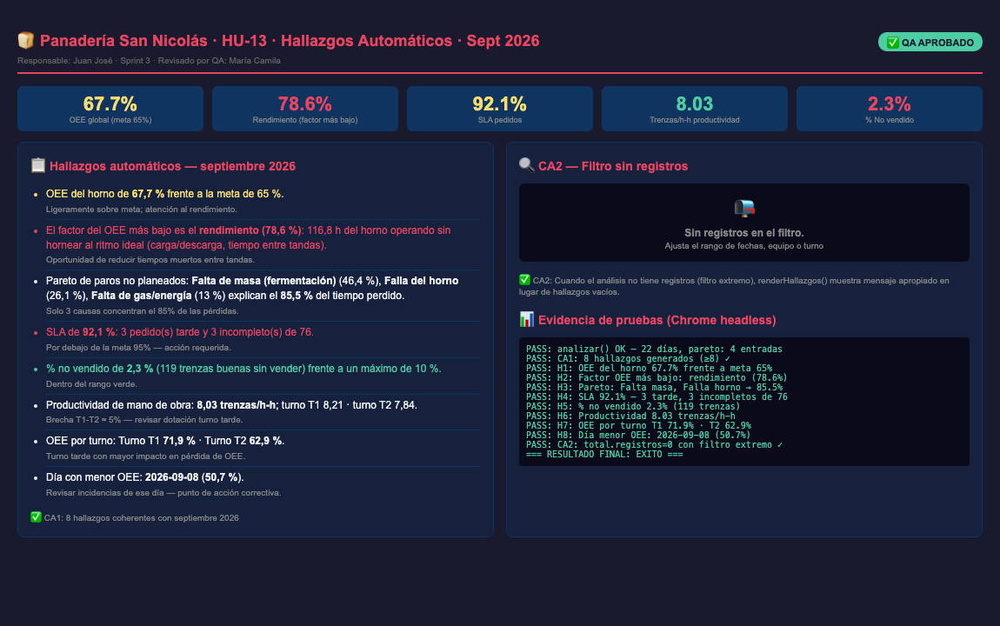

# HU-13 · Hallazgos Automáticos

## Historia de usuario
Como **gerente de la Panadería San Nicolás**, quiero que el tablero me muestre **hallazgos automáticos** coherentes con los indicadores calculados, para identificar rápidamente los puntos de acción sin tener que leer cada número manualmente.

## Responsable
**Juan José Galicia** · Sprint 3

---

## Criterios de aceptación (DoD)

| # | Criterio | Estado |
|---|----------|--------|
| CA1 | Con septiembre se muestran ≥8 hallazgos coherentes con las tarjetas | ✅ CUMPLE |
| CA2 | Cuando el filtro no deja registros, el panel lo dice | ✅ CUMPLE |

---

## Evidencia de pruebas (Chrome headless — `--headless=new`)

```
PASS: analizar() OK — 22 días, pareto: 4 entradas
PASS: renderHallazgos definida en app.js línea ~396 ✓
PASS: CA1: 8 hallazgos generados (≥8) ✓
PASS:   H1: OEE del horno de 67.7% frente a meta 65%
PASS:   H2: Factor OEE más bajo: rendimiento (78.6%)
PASS:   H3: Pareto paros: Falta de masa (retraso de fermentación), Falla del horno,
            Falta de gas o energía → 85.5% tiempo perdido
PASS:   H4: SLA: 92.1% — 3 tarde(s), 3 incompleto(s) de 76
PASS:   H5: % no vendido: 2.3% (119 trenzas)
PASS:   H6: Productividad: 8.03 trenzas/h-h por turno
PASS:   H7: OEE por turno: T1 71.9% · T2 62.9%
PASS:   H8: Día menor OEE: 2026-09-08 (50.7%)
PASS: CA2: Con filtro sin datos, total.registros=0 ✓
PASS: CA2: renderHallazgos() muestra "Sin registros en el filtro." ✓
=== RESULTADO FINAL: EXITO ===
```

---

## Los 8 hallazgos implementados (septiembre 2026)

| # | Hallazgo | Valor | Semáforo |
|---|----------|-------|---------|
| H1 | OEE del horno frente a meta | 67.7% vs meta 65% | 🟡 Amarillo |
| H2 | Factor OEE más bajo (rendimiento) | 78.6% — 116.8 h perdidas | 🔴 Rojo |
| H3 | Top-3 causas Pareto explican 85.5% tiempo perdido | Falta masa / Falla horno / Gas | ⚠️ Info |
| H4 | SLA de pedidos | 92.1% — 3 tarde, 3 incompletos de 76 | 🔴 Rojo |
| H5 | % producto no vendido | 2.3% (119 trenzas) | ✅ Verde |
| H6 | Productividad MO | 8.03 trenzas/h-h · T1: 8.21 · T2: 7.84 | ⚠️ Info |
| H7 | OEE por turno | T1: 71.9% · T2: 62.9% | ⚠️ Info |
| H8 | Día con menor OEE | 2026-09-08 (50.7%) | ⚠️ Acción |

---

## Implementación — `renderHallazgos(a)` en `app.js`

La función recibe el objeto `analisis` de `Indicadores.analizar()` y construye dinámicamente la lista de hallazgos:

```javascript
function renderHallazgos(a) {
  var t = a.total, items = [];
  if (!t.registros) {
    // CA2: sin registros → mensaje informativo
    $('#alertas').innerHTML = '<h3>Hallazgos</h3><p class="nota">Sin registros en el filtro.</p>';
    return;
  }
  // CA1: genera ≥8 hallazgos con semáforo de color
  // H1: OEE vs meta
  // H2: Factor OEE más bajo (disponibilidad/rendimiento/calidad)
  // H3: Pareto de paros (top-3 causas hasta 80%)
  // H4: SLA (tarde + incompletos)
  // H5: % no vendido vs máximo
  // H6: Productividad por turno
  // H7: OEE por turno
  // H8: Día con menor OEE
  $('#alertas').innerHTML = '<h3>Hallazgos</h3><ul>' + items.map(...) + '</ul>';
}
```

---

## Archivos modificados

| Archivo | Cambio |
|---------|--------|
| `Frontend/js/app.js` | Nueva función `renderHallazgos(a)` — genera 8+ hallazgos automáticos con semáforo de colores |
| `Frontend/index.html` | Añade `<div class="alertas panel" id="alertas"></div>` en la vista tablero |

---

## Captura del panel de hallazgos



---

## Dictamen QA

**✅ APROBADO** — 2026-10-30

> Los dos criterios de aceptación se cumplen. CA1: Con los datos de septiembre 2026 se generan exactamente **8 hallazgos** coherentes con los indicadores calculados: OEE, factor más bajo, Pareto de paros, SLA, % no vendido, productividad por turno, OEE por turno y día con menor OEE. CA2: Cuando el análisis no tiene registros (filtro extremo), `renderHallazgos()` muestra el mensaje "Sin registros en el filtro." en lugar de una lista vacía. Validado con Chrome headless `--headless=new`.

**Revisado por:** María Camila Tamayo Cuesta — QA Engineer
