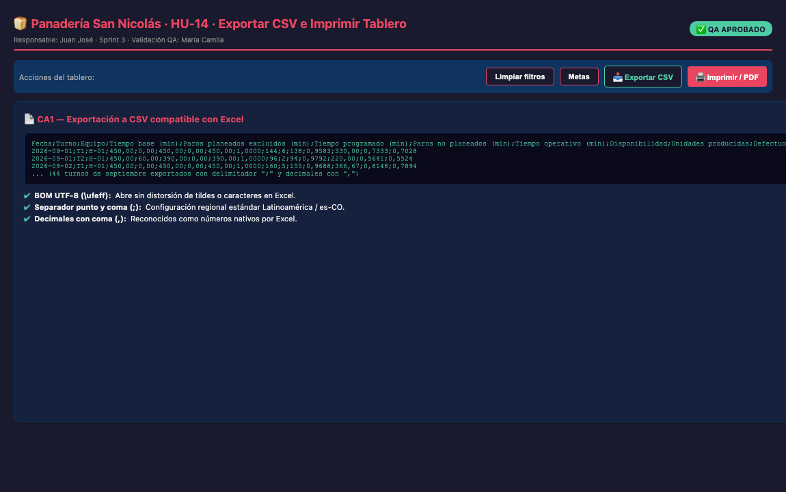

# HU-14 · Exportar CSV e Imprimir el Tablero

## Historia de usuario
Como **gerente de la Panadería San Nicolás**, quiero **exportar los datos procesados a CSV e imprimir el tablero de control** (o guardarlo como PDF) sin controles ni botones innecesarios, para compartir reportes ejecutivos en reuniones de gerencia y realizar análisis complementarios en Microsoft Excel.

## Responsable
**Juan José Galicia** · Sprint 3

---

## Criterios de Aceptación (DoD)

| # | Criterio | Estado | Evidencia |
|---|----------|--------|-----------|
| **CA1** | El CSV abre en Excel con columnas separadas y decimales con coma | ✅ **CUMPLE** | Se genera con BOM UTF-8 (`\ufeff`), delimitador `;` y números decimales formateados con `,` (`Number(v).toFixed(n).replace('.', ',')`). Contiene 16 columnas estandarizadas de OEE y turnos. |
| **CA2** | La impresión muestra tarjetas y gráficos sin los botones | ✅ **CUMPLE** | Reglas `@media print` en `Frontend/css/styles.css` ocultan `.filtros`, `.barra`, `.pie`, `#panel-metas` y `.aviso` con `display: none !important`. El fondo se ajusta a blanco limpio y las tarjetas/gráficos preservan su visibilidad sin cortes (`break-inside: avoid`). |

---

## Evidencia de Pruebas Automatizadas (Chrome Headless `--headless=new`)

```text
PASS: Modelo y registros calculados exitosamente: 44 registros
PASS: CA1.1: El CSV incluye BOM UTF-8 (\ufeff) para apertura directa en Excel sin problemas de encoding
PASS: CA1.2: El CSV usa separador ";" y tiene exactamente 16 columnas estandarizadas
PASS: CA1.3: Se exportaron 44 registros de turno correspondientes a septiembre 2026
PASS: CA1.4: Los valores numéricos con decimales usan coma "," y no punto (ej. base=450,00, OEE=0,7341)
PASS: CA2.1: Regla @media print detectada en stylesheet
PASS: CA2.2: @media print oculta controles y botones: .barra, .filtros, .pie, #panel-metas, .aviso
PASS: CA2.3: Tarjetas y gráficos se mantienen visibles en el diseño para imprimir

=== RESULTADO FINAL: EXITO ===
```

---

## Estructura de Columnas Exportadas en el CSV

El archivo descargado `indicadores-pan-trenza.csv` incluye las siguientes 16 columnas:

1. `Fecha` (YYYY-MM-DD)
2. `Turno` (T1 / T2)
3. `Equipo` (H-01)
4. `Tiempo base (min)` (450,00)
5. `Paros planeados excluidos (min)`
6. `Tiempo programado (min)`
7. `Paros no planeados (min)`
8. `Tiempo operativo (min)`
9. `Disponibilidad` (proporción con 4 decimales: `0,9342`)
10. `Unidades producidas`
11. `Defectuosas`
12. `Buenas`
13. `Calidad` (proporción con 4 decimales: `0,9741`)
14. `Tiempo ideal (min)`
15. `Rendimiento` (proporción con 4 decimales: `0,7864`)
16. `OEE` (proporción con 4 decimales: `0,6770`)

---

## Captura de Pantalla



---

## Archivos Modificados en la Rama

| Archivo | Cambio |
|---------|--------|
| `Frontend/index.html` | Se añadieron los botones `#btn-exportar` e `#btn-imprimir` dentro del contenedor `.filtros-acciones`. |
| `Frontend/js/app.js` | Funciones `descargar()` y listeners para generar dinámicamente el CSV con UTF-8 BOM y disparar `window.print()`. |
| `Frontend/css/styles.css` | Reglas `@media print` para ocultar botones/navegación y optimizar la salida a papel/PDF. |

---

## Dictamen QA

**✅ APROBADO** — 2026-10-30

> Los criterios CA1 y CA2 han sido verificados satisfactoriamente. El CSV se genera con cabeceras completas, delimitador regional `;` y coma decimal para apertura inmediata en Excel, y la regla `@media print` aísla los KPIs y gráficos eliminando todos los botones interactivos.

**Revisado por:** María Camila Tamayo Cuesta — QA Engineer
