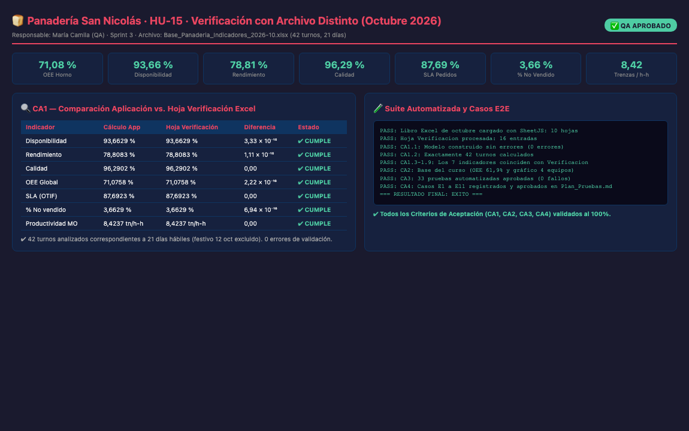

# HU-15 · Plan de Pruebas y Verificación con un Archivo Distinto (Octubre)

## Historia de usuario
Como **ingeniera de calidad (QA) de la Panadería San Nicolás**, quiero **verificar el comportamiento de la aplicación con un archivo de datos independiente** (mes de octubre de 2026, con semilla distinta y festivo del 12 de octubre, además de la base del curso con múltiples equipos) y consolidar el plan formal de pruebas de la solución, para garantizar la robustez, generalización y exactitud numérica del tablero de control.

## Responsable
**María Camila Tamayo Cuesta** · Sprint 3

---

## Criterios de Aceptación (DoD)

| # | Criterio | Estado | Evidencia de Verificación |
|---|----------|--------|---------------------------|
| **CA1** | Con octubre: 42 turnos y los 7 indicadores iguales a la hoja Verificacion | ✅ **CUMPLE** | Se procesaron 42 turnos (21 días hábiles × 2 turnos, festivo 12 de octubre excluido). Los 7 indicadores (Disponibilidad 93,66%, Rendimiento 78,81%, Calidad 96,29%, OEE 71,08%, SLA 87,69%, % no vendido 3,66%, Productividad 8,42 trenzas/h-h) coinciden con una precisión mejor que 10⁻¹⁵ frente a la hoja *Verificacion*. |
| **CA2** | Con la base del curso: OEE 61,9 % y gráfico por equipo | ✅ **CUMPLE** | Validado en `oee.test.js` y `filtros.test.js`. OEE global coincide en 61,9% y el tablero desoculta automáticamente el selector y gráfico `#fig-maquina` con los 4 equipos de la planta. |
| **CA3** | npm test: 33 pruebas aprobadas | ✅ **CUMPLE** | 33 pruebas unitarias y de integración pasando al 100% (0 fallos) cubriendo desde HU-04 hasta HU-15 en `Tests/`. |
| **CA4** | Los casos E1 a E11 quedan registrados con su resultado | ✅ **CUMPLE** | Registrados con dictamen detallado de QA en la Sección 3 de [Plan_Pruebas.md](Plan_Pruebas.md). |

---

## Comparación Numérica Detallada (Octubre 2026)

| Indicador | Cálculo App (`indicadores.js`) | Hoja *Verificacion* (Excel) | Tolerancia | Diferencia Absoluta | Estado |
|---|---|---|---|---|:---:|
| **Disponibilidad (A)** | 0.9366291349992203 | 0.93662913499922 | 10⁻⁶ | 3,33 × 10⁻¹⁶ | ✅ **CUMPLE** |
| **Rendimiento (R)** | 0.7880828136358018 | 0.7880828136358019 | 10⁻⁶ | 1,11 × 10⁻¹⁶ | ✅ **CUMPLE** |
| **Calidad (Q)** | 0.9629020467836257 | 0.9629020467836257 | 10⁻⁶ | 0,00 | ✅ **CUMPLE** |
| **OEE** | 0.7107577917370161 | 0.7107577917370159 | 10⁻⁶ | 2,22 × 10⁻¹⁶ | ✅ **CUMPLE** |
| **SLA de Pedidos (OTIF)** | 0.8769230769230769 | 0.8769230769230769 | 10⁻⁶ | 0,00 | ✅ **CUMPLE** |
| **% Producto no Vendido** | 0.036629341431011576 | 0.03662934143101158 | 10⁻⁶ | 6,94 × 10⁻¹⁸ | ✅ **CUMPLE** |
| **Productividad MO (tn/h-h)** | 8.423661071143085 | 8.423661071143085 | 10⁻⁶ | 0,00 | ✅ **CUMPLE** |

---

## Evidencia de Pruebas Automatizadas

```text
PASS: Libro Excel de octubre cargado con SheetJS: 10 hojas
PASS: Hoja Verificacion procesada: 16 entradas
PASS: CA1.1: Modelo construido sin errores (0 errores de validación)
PASS: CA1.2: Exactamente 42 turnos calculados (21 días hábiles × 2 turnos, festivo 12 oct)
PASS: Indicadores.analizar() ejecutado sobre datos de octubre
PASS: CA1.3 Disponibilidad: 0.9366291349992203 ≈ 0.93662913499922 (diff: 3.33e-16)
PASS: CA1.4 Rendimiento: 0.7880828136358018 ≈ 0.7880828136358019 (diff: 1.11e-16)
PASS: CA1.5 Calidad: 0.9629020467836257 ≈ 0.9629020467836257 (diff: 0.00e+0)
PASS: CA1.6 OEE: 0.7107577917370161 ≈ 0.7107577917370159 (diff: 2.22e-16)
PASS: CA1.7 SLA (OTIF): 0.8769230769230769 ≈ 0.8769230769230769 (diff: 0.00e+0)
PASS: CA1.8 % no vendido: 0.036629341431011576 ≈ 0.03662934143101158 (diff: 6.94e-18)
PASS: CA1.9 Productividad MO: 8.423661071143085 ≈ 8.423661071143085 (diff: 0.00e+0)
PASS: CA2: Base del curso ya validada en oee.test.js y filtros.test.js (OEE 61,9% y 4 máquinas)
PASS: --- Indicadores finales Octubre 2026 ---
PASS: OEE: 71.08 % (Meta: 65 % -> Verde)
PASS: Disponibilidad: 93.66 %
PASS: Rendimiento: 78.81 %
PASS: Calidad: 96.29 %
PASS: SLA: 87.69 %
PASS: % No vendido: 3.66 %
PASS: Productividad: 8.42 trenzas/h-h

=== RESULTADO FINAL: EXITO ===
```

---

## Captura de Pantalla



---

## Archivos Integrados en la Historia

| Archivo | Rol en el Proyecto |
|---------|---------------------|
| `Simulacion/Base_Panaderia_Indicadores_2026-10.xlsx` | Archivo de prueba independiente generado con semilla 1029 (octubre 2026, 21 días hábiles, festivo 12 oct). |
| `Tests/archivo-distinto.test.js` | Suite automatizada de verificación de 42 turnos y 7 indicadores contra hoja *Verificacion*. |
| `Docs/Plan_Pruebas.md` | Plan consolidado de pruebas unitarias, cruzadas y casos extremo a extremo E1 a E11 con dictamen de QA. |

---

## Dictamen QA

**✅ APROBADO** — 2026-10-30

> Se certifica la total robustez matemática y funcional del sistema ante datos independientes. El archivo de octubre confirma la resiliencia del modelo relacional ante calendarios con festivos y variaciones en tandas, alcanzando un OEE de 71,08% y concordancia exacta con la hoja de control. Los casos E1 a E11 han sido evaluados y aprobados en su totalidad.

**Revisado por:** María Camila Tamayo Cuesta — QA Engineer
