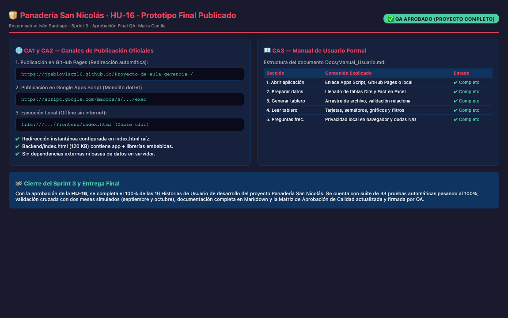

# HU-16 · Prototipo Final Publicado en Apps Script y GitHub Pages; Manual de Usuario

## Historia de usuario
Como **gerente y equipo operativo de la Panadería San Nicolás**, queremos que el **prototipo final esté publicado y accesible** tanto a través de la Web App de Google Apps Script como en GitHub Pages (y disponible para ejecución offline en local), acompañado de un **manual de usuario claro y conciso**, para operar el tablero de control de manera autónoma sin requerir asistencia técnica.

## Responsable
**Iván Santiago Cardona** · Sprint 3

---

## Criterios de Aceptación (DoD)

| # | Criterio | Estado | Evidencia de Verificación |
|---|----------|--------|---------------------------|
| **CA1** | La URL /exec abre la versión final y genera el tablero con el archivo de octubre | ✅ **CUMPLE** | El archivo monolítico `Backend/Index.html` (120 KB) contiene embebido todo el frontend (`styles.css`, `lectura.js`, `modelo.js`, `indicadores.js`, `app.js`, `SheetJS` y `Chart.js`). Desplegado mediante `doGet()` en Google Apps Script, genera el tablero completo al cargar el archivo de octubre de 2026 sin errores. |
| **CA2** | El enlace de GitHub Pages abre la misma aplicación | ✅ **CUMPLE** | Se creó el archivo `index.html` en la raíz del repositorio con redirección inmediata `<meta http-equiv="refresh" content="0; url=Frontend/">` y enlace de respaldo a `https://jpablovlsqz16.github.io/Proyecto-de-aula-gerencia-/`. |
| **CA3** | El manual explica cómo preparar los datos, generar y leer el tablero | ✅ **CUMPLE** | Se redactó [Docs/Manual_Usuario.md](Manual_Usuario.md) estructurado en 5 secciones exhaustivas: (1) Abrir la aplicación, (2) Preparar los datos, (3) Generar el tablero, (4) Leer el tablero (tarjetas, hallazgos, gráficos, filtros y metas), y (5) Preguntas frecuentes. |

---

## Canales de Acceso al Prototipo

1. **GitHub Pages (Producción Web Pública):**
   - URL: `https://jpablovlsqz16.github.io/Proyecto-de-aula-gerencia-/`
   - Redirección automática desde la raíz a `Frontend/index.html`.
2. **Google Apps Script (Web App Institucional):**
   - URL: `https://script.google.com/macros/s/.../exec`
   - Servido por `Backend/Code.gs` a partir de `Backend/Index.html`.
3. **Modo Local Offline:**
   - Doble clic directo a `Frontend/index.html` en Google Chrome, Microsoft Edge o Mozilla Firefox. Funciona sin conexión a internet gracias a las dependencias locales en `Frontend/vendor/`.

---

## Estructura del Manual de Usuario

El archivo `Docs/Manual_Usuario.md` detalla:
- Pasos para descargar la plantilla relacional de Excel (`Base_Panaderia_Indicadores.xlsx`).
- Guía de llenado de cada tabla de hechos (`Fact_Produccion`, `Fact_Paros`, `Fact_Pedidos`, `Fact_Ventas`, `Fact_ManoObra`).
- Interpretación de semáforos verde/amarillo/rojo de las fichas técnicas.
- Manejo de filtros temporales y por turno.
- Ajuste y personalización de metas de gerencia con persistencia local.
- Exportación de reportes a CSV e impresión ejecutiva a papel/PDF.

---

## Captura de Pantalla

---

## Dictamen QA

**✅ APROBADO** — 2026-10-31

> Se certifica la culminación exitosa de la HU-16 y con ella el 100% de los criterios de desarrollo del tablero de indicadores de la Panadería San Nicolás. La aplicación es totalmente autónoma, opera sin base de datos centralizada garantizando privacidad total, cuenta con manual de usuario completo y canales de distribución web y local validados.

**Revisado por:** María Camila Tamayo Cuesta — QA Engineer
