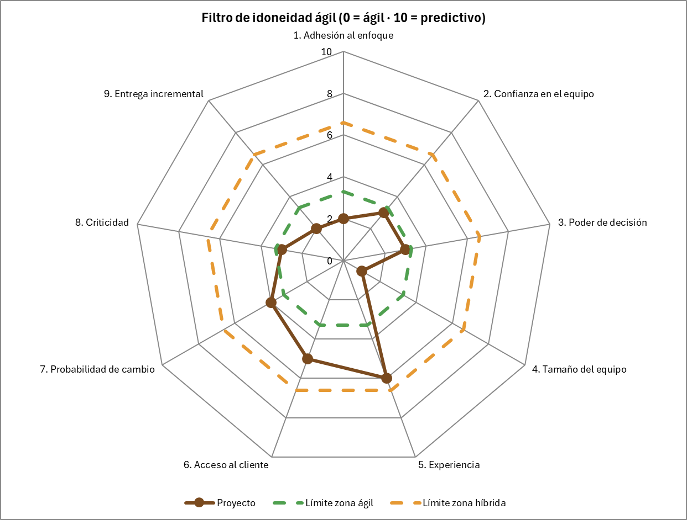

# HU-17 · Modelo Híbrido

**Segunda entrega · Tablero de Indicadores · Panadería San Nicolás**  
Proyecto de Aula 2026-2 · Gerencia de Proyectos · Ingeniería Industrial · Universidad de Medellín

| Campo | Detalle |
|---|---|
| **Historia de usuario** | Como Scrum Master, quiero definir qué se gestionó de forma predictiva y qué de forma ágil, para justificar el modelo híbrido del proyecto. |
| **Punto de la guía** | 1. Análisis y aplicación del modelo híbrido: qué se gestionó de forma predictiva, qué de forma ágil y por qué. |
| **Responsable** | Juan Pablo (Scrum Master) · 5 puntos · Prioridad alta · Sprint 2 |

---

## 1. Por qué un modelo híbrido

El proyecto tiene dos tipos de trabajo. Una parte es estable: las fechas de entrega, el contenido del informe, el presupuesto y los riesgos están fijados por la guía del curso desde el inicio. La otra se descubre haciendo: la aplicación del tablero, cuyos criterios de aceptación entrega el docente en cada Sprint Planning. Además, Scrum no define el presupuesto, el business case, los riesgos ni la gobernanza, que siguen siendo trabajo de la gerencia del proyecto. Por eso se combina un marco predictivo de gobierno con Scrum para el desarrollo.

---

## 2. Filtro de idoneidad ágil

Se aplicó el filtro de la *Agile Practice Guide* (anexo X3): 9 preguntas calificadas de 0 a 10, donde el centro del radar favorece lo ágil y el borde lo predictivo.

| Pregunta | Puntaje | Justificación |
|---|---|---|
| **Cultura** | | |
| 1. Adhesión al enfoque | 2 | El docente y el equipo trabajan con Scrum. |
| 2. Confianza en el equipo | 3 | El docente revisa en las Reviews y las entregas. |
| 3. Poder de decisión | 3 | El equipo decide cómo; el docente, qué se acepta. |
| **Equipo** | | |
| 4. Tamaño del equipo | 1 | 4 integrantes. |
| 5. Experiencia | 6 | Poca experiencia en Scrum y Apps Script. |
| 6. Acceso al cliente | 5 | Docente dos veces por semana; panadería esporádica. |
| **Proyecto** | | |
| 7. Probabilidad de cambio | 4 | Criterios cambian por sprint; fechas fijas. |
| 8. Criticidad | 3 | Una falla no causa pérdidas graves. |
| 9. Entrega incremental | 2 | La aplicación se entrega por partes. |
| **Promedio** | **3,2** | **Zona ágil, con experiencia y acceso al cliente en la zona híbrida.** |

 

*Figura 1. Radar del filtro de idoneidad. Elaboración propia con base en PMI y Agile Alliance (2017), anexo X3.*

**Lectura:** La cultura, el tamaño del equipo, la criticidad y la entrega incremental favorecen Scrum para la aplicación. La experiencia del equipo, el acceso al cliente y las fechas fijas piden un marco predictivo para el gobierno.  
**Resultado:** Enfoque híbrido, mayormente ágil.

---

## 3. Qué se gestionó de forma predictiva y qué de forma ágil

Cada entregable se ubicó en el modelo de incertidumbre y complejidad inspirado en Stacey (incertidumbre del qué y del cómo) para elegir su enfoque:

| Entregable | Zona | Enfoque | Por qué |
|---|---|---|---|
| Acta, EDT, cronograma y presupuesto | Simple | Predictivo | Contenido y fechas fijados por la guía; Scrum no define presupuesto. |
| Estudios, business case y riesgos | Complicado | Predictivo | Se resuelven con análisis; Scrum no cubre riesgos ni business case. |
| Hitos de entrega y gobernanza | Simple | Predictivo | Fechas innegociables (8 sep y 29 oct); control de cambios formal. |
| Aplicación: carga, cálculo y tablero | Complejo | Ágil (Scrum) | Requisitos que se descubren con el Product Owner sprint a sprint. |
| Pruebas y validación | Complicado | Ágil | Se hacen dentro de cada sprint con la definición de terminado. |
| Documentación del informe final | Simple | Kanban | Flujo de tareas pequeñas con límite de trabajo en curso. |

 

| Herramientas predictivas | Herramientas ágiles |
|---|---|
| • Acta de constitución y EDT de 3 niveles • Línea base de costo y reserva de contingencia • Registro y matriz de riesgos • Valor ganado (SPI y CPI) • Puntos de decisión en cada entrega | • Product Backlog con historias y criterios de aceptación • Sprints con Planning, Daily, Review y Retrospectiva • Estimación con Fibonacci (Planning Poker) • Velocidad y burndown • Tablero en Trello y definición de terminado |

---

## 4. Forma de combinación

El proyecto usa la combinación simultánea (*Agile Practice Guide*, cap. 3): mientras la aplicación se construye por sprints, la documentación y los hitos siguen el plan predictivo. En conjunto es mayormente ágil con un marco predictivo de gobierno. Los enfoques se integran así:

1. Un solo acta, un solo presupuesto y unos solos hitos de gobierno.
2. Un solo tablero en Trello con las historias de la aplicación y las tareas de documentación.
3. Lo aceptado en cada Sprint Review es la evidencia que se presenta en las entregas.
4. Los cambios de la aplicación se gestionan repriorizando el backlog; los que afectan alcance, fechas o presupuesto, con registro formal.

---

## 5. Conclusión

El proyecto es **híbrido, mayormente ágil**: la aplicación se construye con Scrum porque sus requisitos se descubren con el Product Owner, y las fechas fijas, el contenido de la guía, el presupuesto, el business case y los riesgos se gestionan de forma predictiva.

---

## Criterios de aceptación

| CA | Criterio | Cumplimiento |
|---|---|---|
| **CA1** | Se presenta el radar del filtro de idoneidad. | Sección 2 |
| **CA2** | Cada entregable tiene su enfoque y su justificación. | Sección 3 |
| **CA3** | Se explica la forma de combinación de los enfoques. | Sección 4 |
| **CA4** | La información queda en Google Sheets. | Pendiente: hoja PROYECTO de la aplicación |

---

## Referencias

- Project Management Institute y Agile Alliance. (2017). *Agile practice guide*. PMI.
- Schwaber, K. y Sutherland, J. (2020). *La Guía de Scrum*. https://scrumguides.org/
- Álvarez Valencia, R. A. (2026). *Lean, Kanban y enfoques híbridos; Scrum y la gerencia ágil de proyectos* [Presentaciones de clase]. Universidad de Medellín.
