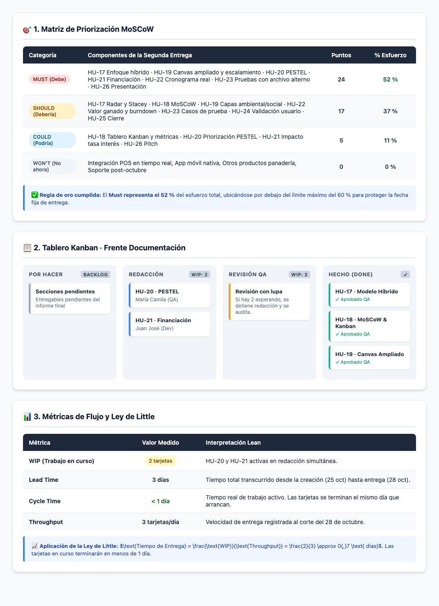

# HU-18 · MoSCoW y Kanban
**Segunda entrega · Panadería San Nicolás**  
*Proyecto de Aula 2026-2 · Gerencia de Proyectos · Ingeniería Industrial · Universidad de Medellín*

---

| Campo | Detalle |
| :--- | :--- |
| **Historia de usuario** | Como QA, quiero priorizar el alcance con MoSCoW y gestionar un frente del proyecto con un tablero Kanban, para proteger lo imprescindible con la fecha fija de entrega. |
| **Responsable** | María Camila (QA) · 3 puntos · Sprint 1 (26 – 28 oct) |

---

## 📸 Resumen Visual Ejecutivo (Tablas y Kanban)

A continuación se presentan las tablas organizadas visualmente con sus indicadores de esfuerzo, diseño del tablero y métricas de flujo:

---

## 1. Priorización MoSCoW (Detalle en Texto)

Con fecha fija, solo se negocia el alcance, nunca la calidad. Componentes de la segunda entrega:

| Categoría | Componentes | Puntos | % |
| :--- | :--- | :---: | :---: |
| **Must** | HU-17 qué fue predictivo y qué ágil · HU-19 Business Model Canvas y escalamiento · HU-20 PESTEL · HU-21 comparación de financiación · HU-22 cronograma planeado vs. ejecutado · HU-23 prueba con archivo distinto · HU-26 presentación y demo | 24 | 52 % |
| **Should** | HU-17 radar y Stacey · HU-18 MoSCoW · HU-19 capas ambiental y social · HU-22 valor ganado y burndown · HU-23 casos de prueba · HU-24 validación con el usuario · HU-25 resultados y cierre | 17 | 37 % |
| **Could** | HU-18 tablero Kanban y métricas · HU-20 priorización del PESTEL · HU-21 efecto de la tasa de interés · HU-26 pitch | 5 | 11 % |
| **Won’t** | Integración con punto de venta, app móvil, otros productos, soporte después de octubre | 0 | 0 % |

> **Nota:** El **Must es el 52 %** del esfuerzo, cumpliendo con la regla de estar por debajo del 60 % recomendado para proteger el cronograma.

---

## 2. Kanban del frente de documentación

| Por hacer | Redacción (WIP: 2) | Revisión QA (WIP: 2) | Ajustes (WIP: 1) | Hecho |
| :--- | :--- | :--- | :--- | :--- |
| Secciones pendientes del informe | Una tarjeta por persona | Si hay 2 esperando, se deja de redactar y se revisa | Correcciones de QA | Sin observaciones y dentro del límite de páginas |

---

## 3. Métricas de flujo (Corte: miércoles 28 de octubre)

### Estado de las tarjetas

| Tarjeta | Creada | Empezada | Terminada | Estado |
| :--- | :---: | :---: | :---: | :---: |
| **HU-17 Modelo híbrido** | 25 oct | 28 oct | 28 oct | Hecho |
| **HU-18 MoSCoW y Kanban** | 25 oct | 28 oct | 28 oct | Hecho |
| **HU-19 CANVAS ampliado** | 25 oct | 28 oct | 28 oct | Hecho |
| **HU-20 PESTEL** | 25 oct | 28 oct | — | En progreso |
| **HU-21 Financiación** | 25 oct | 28 oct | — | En progreso |

### Indicadores Kanban

| Métrica | Valor | Lectura |
| :--- | :---: | :--- |
| **WIP** | 2 tarjetas | HU-20 y HU-21 en progreso. |
| **Lead time** | 3 días | Desde que se crearon (25 oct) hasta que se terminaron (28 oct). |
| **Cycle time** | Menos de 1 día | Se terminaron el mismo día en que se empezaron. |
| **Throughput** | 3 tarjetas por día | Tres tarjetas terminadas el 28 de octubre. |

> **Hallazgo:** Casi todo el *lead time* fue tiempo de espera (3 días sin empezar frente a menos de 1 día de trabajo activo), el desperdicio típico que señala Lean.  
> Con la **Ley de Little**: $\text{WIP} \div \text{Throughput} = 2 \div 3 \approx 0{,}7 \text{ días}$; las dos tarjetas en progreso deberían terminar en menos de un día. Las métricas se actualizan en la Sprint Review.

---

## Referencias

* **Agile Business Consortium.** (2014). *MoSCoW prioritisation*.
* **Kanban University.** (2021). *The official guide to the Kanban Method*.
* **Álvarez Valencia, R. A.** (2026). *Lean, Kanban y enfoques híbridos* [Presentación de clase]. Universidad de Medellín.
