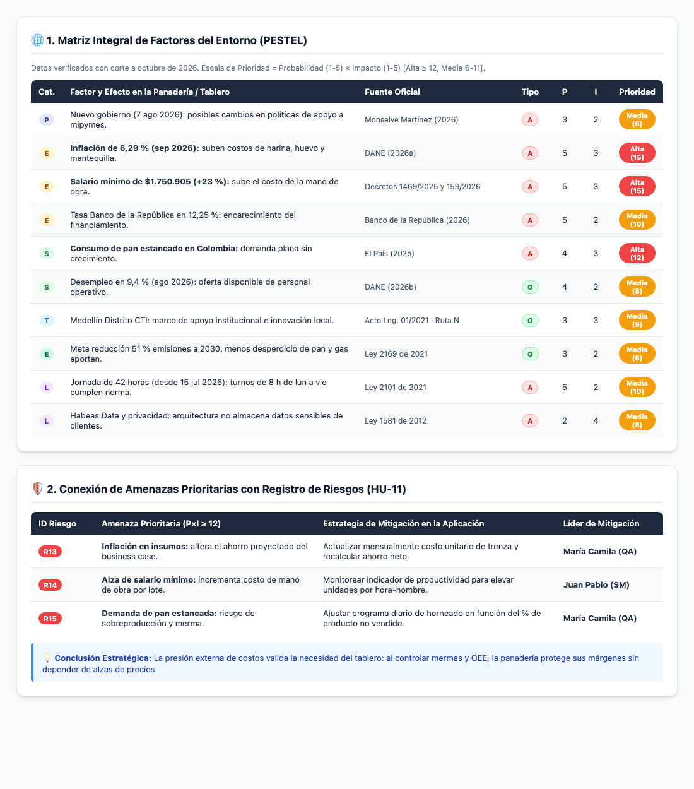

# HU-20 · Análisis PESTEL
**Segunda entrega · Panadería San Nicolás**  
*Proyecto de Aula 2026-2 · Gerencia de Proyectos · Ingeniería Industrial · Universidad de Medellín*

---

| Campo | Detalle |
| :--- | :--- |
| **Historia de usuario** | Como QA, quiero realizar el análisis PESTEL, para identificar los factores del entorno que impulsan o amenazan a la panadería y a la aplicación. |
| **Responsable** | María Camila (QA) · 3 puntos · Sprint 1 (26 – 28 oct) |

---

## 📸 Resumen Visual Ejecutivo (Matriz PESTEL y Gestión de Riesgos)

A continuación se presentan las tablas organizadas visualmente con sus categorías del macroentorno, fuentes verificadas, evaluación de probabilidad/impacto y conexión con la matriz de riesgos:

---

## 1. Factores PESTEL (Detalle en Texto)

Datos con corte a **octubre de 2026**.  
* **O** = Oportunidad, **A** = Amenaza.  
* **Prioridad** = Probabilidad (P: 1 a 5) × Impacto (I: 1 a 5):  
  * **Alta** $\ge 12$  
  * **Media** de $6$ a $11$  
  * **Baja** $\le 5$

| Cat. | Factor y efecto en la panadería / tablero | Fuente oficial | Tipo | P | I | Nivel de Prioridad |
| :---: | :--- | :--- | :---: | :---: | :---: | :---: |
| **P** | Nuevo gobierno desde el 7 de agosto de 2026: posibles cambios en políticas de apoyo a mipymes. | Monsalve Martínez (2026) | A | 3 | 2 | Media (6) |
| **E** | **Inflación de 6,29 % (sep. 2026):** suben los costos de harina, huevo y mantequilla. | DANE (2026a) | A | 5 | 3 | **Alta (15)** |
| **E** | **Salario mínimo de $1.750.905 (+23 %):** sube el costo de los operarios de planta. | Decretos 1469 de 2025 y 159 de 2026 | A | 5 | 3 | **Alta (15)** |
| **E** | Tasa del Banco de la República en 12,25 %: encarecimiento del crédito productivo. | Banco de la República (2026) | A | 5 | 2 | Media (10) |
| **S** | **Consumo de pan en Colombia no crece:** la demanda del mercado es estable sin expansión. | El País (2025) | A | 4 | 3 | **Alta (12)** |
| **S** | Desempleo de 9,4 % (ago. 2026): oferta disponible de personal operativo para la panadería. | DANE (2026b) | O | 4 | 2 | Media (8) |
| **T** | Medellín es Distrito de Ciencia, Tecnología e Innovación: marco y oferta de apoyo de Ruta N. | Acto Legislativo 01 de 2021; Ruta N | O | 3 | 3 | Media (9) |
| **E** | Meta de reducir 51 % las emisiones a 2030: menos desperdicio de pan y menor consumo de gas suman. | Ley 2169 de 2021 | O | 3 | 2 | Media (6) |
| **L** | Jornada de 42 horas (desde 15 jul 2026): los turnos de 8 h de lunes a viernes cumplen la norma. | Ley 2101 de 2021 | A | 5 | 2 | Media (10) |
| **L** | Protección de datos personales: la aplicación no almacena datos sensibles de clientes finales. | Ley 1581 de 2012 | A | 2 | 4 | Media (8) |

---

## 2. Amenazas prioritarias y registro de riesgos (Conexión HU-11)

Las tres amenazas de nivel alto pasan al registro de riesgos de la **HU-11** como riesgos nuevos:

| ID Riesgo | Amenaza Prioritaria | Estrategia de Respuesta (Mitigación) | Responsable |
| :---: | :--- | :--- | :--- |
| **R13** | La inflación sube el costo de insumos y altera el ahorro del business case. | **Mitigar:** Actualizar cada mes el costo unitario por trenza y recalcular el ahorro proyectado. | **María Camila (QA)** |
| **R14** | El aumento del salario mínimo sube el costo de la mano de obra directa. | **Mitigar:** Emplear el indicador de productividad para elevar unidades por hora-hombre. | **Juan Pablo (SM)** |
| **R15** | La demanda de pan no crece (mercado estancado). | **Mitigar:** Ajustar la producción diaria con base en el % de producto no vendido. | **María Camila (QA)** |

> **Lectura estratégica:** El entorno macroeconómico presiona fuertemente los costos fijos y variables; es precisamente por esto que el tablero de indicadores cobra mayor valor: permite a la panadería evitar la sobreproducción y optimizar el rendimiento operativo con los mismos recursos.

---

## Referencias

* **Banco de la República.** (2026, 30 de septiembre). *Decisión de política monetaria: tasa de interés en 12,25 %*.
* **DANE.** (2026a). *Índice de precios al consumidor: septiembre de 2026*.
* **DANE.** (2026b). *Mercado laboral: agosto de 2026*.
* **El País.** (2025). *¿Por qué el consumo de pan no crece en Colombia? Esto dicen los productores*.
* **Monsalve Martínez, M. C.** (2026, 21 de junio). *Mapa de la segunda vuelta*. Portafolio.
* **Normativa legal:** Acto Legislativo 01 de 2021; Ley 1581 de 2012; Ley 2101 de 2021; Ley 2169 de 2021; Decretos 1469 de 2025 y 159 de 2026.
* **Álvarez Valencia, R. A.** (2026). *Lean, Kanban y enfoques híbridos* [Presentación de clase]. Universidad de Medellín.
