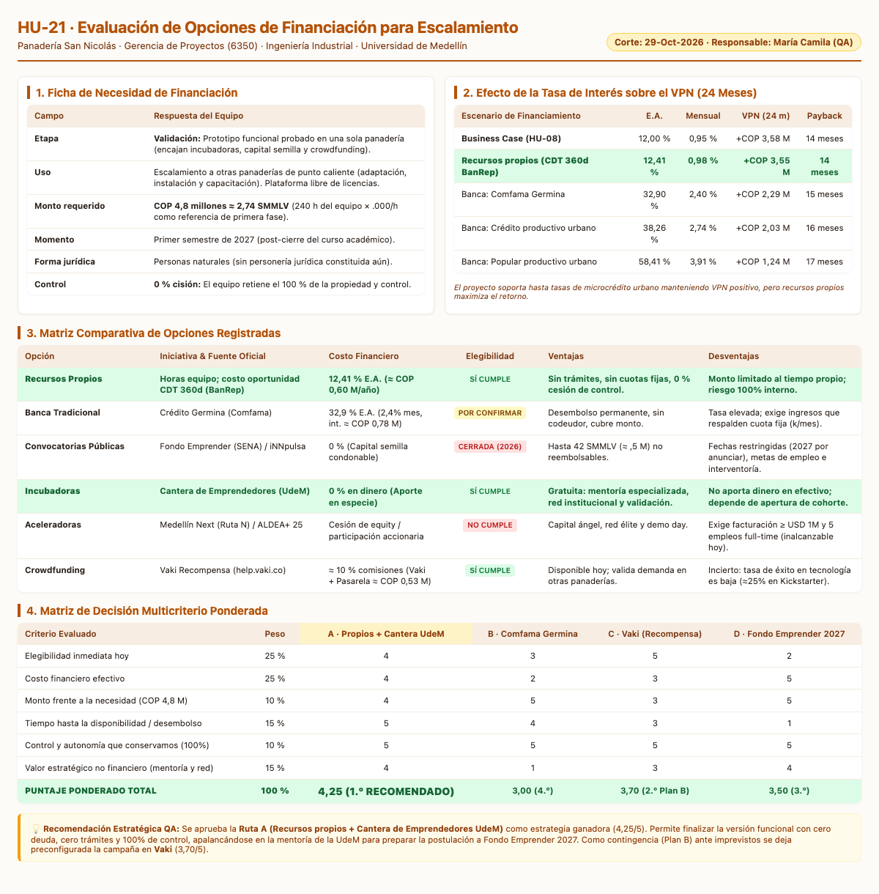

# HU-21 · Evaluar Opciones de Financiación
**Gestión de la Segunda Entrega · Panadería San Nicolás**  
*Proyecto de Aula 2026-2 · Gerencia de Proyectos (6350-161) · Ingeniería Industrial · Universidad de Medellín*

---

| Campo | Detalle |
| :--- | :--- |
| **Historia de usuario** | Como QA, quiero comparar las opciones de financiación, para recomendar la más conveniente para escalar la aplicación. |
| **Responsable** | María Camila (QA) · 5 puntos · Prioridad Media · Sprint 1 · Punto 3 de la guía |
| **Corte de información** | 29 de octubre de 2026 |

---

## 📸 Resumen Visual Ejecutivo (Ficha, Sensibilidad y Matriz Multicriterio)

A continuación se presentan las tablas organizadas visualmente con la ficha de necesidad, el análisis de sensibilidad de tasas sobre el VPN a 24 meses, la comparación de iniciativas y la matriz de decisión multicriterio:

---

## 1. Ficha de Necesidad de Financiación

Se siguen las fases de la guía de taller de la Clase 20 (*Álvarez Valencia, 2026*). Lo que no proviene de la guía ni del business case (HU-08) se documenta como supuesto de proyecto:

| Campo | Respuesta del Equipo |
| :--- | :--- |
| **Etapa** | **Validación.** La aplicación tiene un prototipo funcional y se prueba en una sola panadería. En esta etapa encajan incubadoras, capital semilla, convocatorias y crowdfunding de recompensa (*Berger y Udell, 1998*). |
| **Uso** | **Escalar la aplicación** a otras panaderías de punto caliente (vía de escalamiento definida en HU-19): adaptarla, instalarla y capacitar a cada establecimiento. La plataforma base (Apps Script y Google Sheets) no cobra licencias. |
| **Monto** | **COP 4,8 millones ≈ 2,74 SMMLV** (SMMLV 2026 fijado en $1.750.905, Decreto 159 de 2026). *Supuesto:* se toma la misma inversión del business case (240 horas × $20.000/h) como referencia para la primera fase de escalamiento. |
| **Momento** | **Primer semestre de 2027**, tras el cierre del curso académico (*Supuesto*). |
| **Forma jurídica** | **Personas naturales.** El equipo actúa actualmente sin personería jurídica mercantil constituida. |
| **Control** | **0 % cesión de propiedad:** No se contempla ceder participación accionaria en esta etapa (*Supuesto acordado*). |

---

## 2. Opciones de Financiación Registradas

Se investigaron y contrastaron las alternativas con fuentes e iniciativas oficiales al corte del 29 de octubre de 2026:

| Opción | Iniciativa y Fuente Oficial | Estado al 29-Oct-2026 | Monto Potencial | ¿Cumplimos hoy? |
| :--- | :--- | :--- | :--- | :---: |
| **Recursos propios** | Horas del equipo; costo de oportunidad con el CDT a 360 días · Banco de la República (`suameca.banrep.gov.co`) | Serie semanal; dato del 23-oct-2026 | Lo que el equipo aporte (240 h valoradas en COP 4,8 M) | **Sí** |
| **Banca** | Crédito Germina · Comfama (`comfama.com`) | Permanente | COP 1 a 7 M | **Por confirmar** (sin flujo de ingresos demostrable) |
| **Convocatorias** | Fondo Emprender · SENA (`fondoemprender.com`) e iNNpulsa (`innpulsacolombia.com`) | Fondo Emprender cerrada (2-mar a 6-abr-2026); iNNpulsa sin convocatorias activas para Medellín | Fondo Emprender: hasta 42 SMMLV (≈ COP 73,5 M en Conv. 153) | **No** (cerradas al corte) |
| **Incubadoras** | Cantera de Emprendedores · UdeM (`desarrolloempresarial.udemedellin.edu.co`) | Última cohorte publicada: 2023-2; por confirmar nueva convocatoria | No desembolsa capital en efectivo; aporta mentoría | **Sí** en requisitos de comunidad UdeM |
| **Aceleradoras** | Medellín Next · Ruta N (`rutanmedellin.org`) / ALDEA+ 25 (iNNpulsa) | Medellín Next cerrada (31-jul-2026); ALDEA+ 25 cerrada (17-feb-2026) | Inversión o estipendio según programa | **No** (exige tracción > USD 1M) |
| **Crowdfunding** | Vaki Recompensa (`help.vaki.co`) | Permanente | Lo que recaude la campaña | **Sí** |

---

## 3. Comparación por Criterios de Evaluación

Evaluación comparativa sobre el requerimiento base de **COP 4,8 millones**:

| Opción | Costo Financiero | Requisitos | Plazo | Ventajas Clave | Desventajas / Riesgos |
| :--- | :--- | :--- | :--- | :--- | :--- |
| **Recursos propios** | 12,41 % E.A. de costo de oportunidad (≈ COP 0,60 M/año) | Disponibilidad de horas/fondos del equipo | Inmediato; sin deuda | Cero intereses, cero trámites, 100 % control | Monto limitado; riesgo absorbido totalmente por el equipo |
| **Banca (Germina)** | 2,4 % mensual ≈ 32,9 % E.A. (Cuota ≈ $465.109/mes; intereses ≈ COP 0,78 M a 12 m) | Capacidad de pago demostrable; negocio en marcha | 12 a 36 meses | Desembolso permanente, sin codeudor | Costo financiero alto; exige cuota fija obligatoria |
| **Convocatorias (Fondo Emprender)** | 0 % de interés (Capital condonable cumpliendo metas) | Últimos semestres u 80 % créditos; plan de negocio; generación de empleo | Anual (ventana ≈ 5 semanas); interventoría | Mayor volumen de capital sin costo financiero | Fechas inflexibles; alta burocracia e interventoría |
| **Incubadoras (Cantera UdeM)** | 0 % monetario (Aporte institucional) | Integrante activo UdeM; superar filtro de postulación | Cohorte de 16 semanas | Gratuita; red institucional, mentoría y validación | No provee capital líquido para operar |
| **Aceleradoras (Medellín Next)** | Equity / participación en la empresa | Facturar ≥ USD 1 M/año y equipo > 5 personas full-time | 3 a 4 meses (*Hochberg, 2016*) | Capital inteligente, demo day e inversión ángel | Inviable en fase actual; dilución de propiedad |
| **Crowdfunding (Vaki)** | ≈ 10 % (6 % Vaki + 4 % pasarela ≈ COP 0,53 M) | Red de apoyo y estructura de recompensas atractivas | Duración de campaña (30–60 días) | Valida tracción de mercado y financia sin deuda | Incertidumbre de cierre (sólo 25 % de éxito en tech) |

---

## 4. Efecto de la Tasa de Interés sobre el VPN (Sensibilidad a 24 Meses)

Se proyectó el flujo de caja a 24 meses bajo distintos costos de capital:

$$\text{VPN} = -I_0 + \sum_{t=1}^{24} \frac{\text{Flujo}_t}{(1 + i_m)^t}$$

| Tasa de Descuento | Tasa E.A. | Tasa Mensual | VPN a 24 Meses | Período de Recuperación |
| :--- | :---: | :---: | :---: | :---: |
| **Business case inicial (HU-08)** | 12,00 % | 0,95 % | **+COP 3,58 M** | 14 meses |
| **Recursos propios (CDT 360 días BanRep)** | **12,41 %** | **0,98 %** | **+COP 3,55 M** | **14 meses** |
| **Banca: Comfama Germina** | 32,90 % | 2,40 % | +COP 2,29 M | 15 meses |
| **Banca: Crédito productivo urbano** | 38,26 % | 2,74 % | +COP 2,03 M | 16 meses |
| **Banca: Popular productivo urbano (≤ 6 SMMLV)** | 58,41 % | 3,91 % | +COP 1,24 M | 17 meses |

> **Conclusión del análisis de sensibilidad:** El proyecto demuestra alta resiliencia financiera: incluso bajo tasas extremas de microcrédito (58,41 % E.A.), el VPN permanece positivo (+COP 1,24 M) y el *payback* sólo se dilata 3 meses. Sin embargo, apalancarse con **recursos propios (12,41 % E.A.)** maximiza el valor actual neto en **+COP 3,55 M**.

---

## 5. Matriz de Decisión Multicriterio Ponderada

Se ponderaron seis factores estratégicos con escala de calificación de 1 a 5:

| Criterio Evaluado | Peso Relativo | A · Propios + Cantera UdeM | B · Comfama Germina | C · Vaki (Recompensa) | D · Fondo Emprender 2027 |
| :--- | :---: | :---: | :---: | :---: | :---: |
| **Elegibilidad inmediata hoy** | 25 % | 4 | 3 | 5 | 2 |
| **Costo financiero efectivo** | 25 % | 4 | 2 | 3 | 5 |
| **Monto vs. Necesidad (COP 4,8 M)** | 10 % | 4 | 5 | 3 | 5 |
| **Tiempo hasta disponibilidad** | 15 % | 5 | 4 | 3 | 1 |
| **Control que conservamos (100 %)** | 10 % | 5 | 5 | 5 | 5 |
| **Valor no financiero (mentoría y red)** | 15 % | 4 | 1 | 3 | 4 |
| **Puntaje Ponderado Total** | **100 %** | **4,25 (1.º Ganador)** | **3,00 (4.º)** | **3,70 (2.º Plan B)** | **3,50 (3.º)** |

---

## 6. Recomendación Estratégica y Plan de Acción QA

1. **Ruta Principal Recomendada (Ruta A):**
   - **Fórmula:** **Recursos propios (horas del equipo) + Cantera de Emprendedores UdeM.**
   - **Puntaje:** **4,25 / 5,00.**
   - **Justificación:** Coincide con la teoría de la jerarquía financiera de *Myers y Majluf (1984)*: priorizar fondos internos para mitigar asimetrías de información y evitar deuda con intereses onerosos (32,9 % en banca). No se cede propiedad y se aprovecha el ecosistema institucional de la Universidad de Medellín.
2. **Plan de Contingencia (Plan B):**
   - Si se requiere acelerar el flujo de caja, se ejecutará una campaña de crowdfunding de recompensa en **Vaki** (Puntaje 3,70), prevalidando la demanda con dueños de panaderías.
3. **Hoja de Ruta Temporal:**
   - **Corto plazo (actual):** Culminar y estabilizar el prototipo funcional con las horas de desarrollo del equipo.
   - **Mediano plazo (1.er semestre 2027):** Ingresar a la Cantera de Emprendedores UdeM y estructurar el plan de negocio para la convocatoria nacional de Fondo Emprender.
   - **Largo plazo (2.º semestre 2027):** Despliegue comercial en panaderías de punto caliente del Valle de Aburrá.

---

## 📚 Referencias Bibliográficas

- Álvarez Valencia, R. A. (2026). *Guía de taller: ¿quién financia su proyecto?* [Material de clase, Gerencia de Proyectos, Clase 20]. Universidad de Medellín.
- Banco de la República. (s. f.). *Consulta exprés: CDTs a 90 (DTF), 180 y 360 días* [Serie estadística]. https://suameca.banrep.gov.co/estadisticas-economicas/informacionSerie/220003/tasas_interes_cdt_dtf
- Banco Distrital de Medellín. (s. f.). *Líneas de crédito*. Alcaldía de Medellín. https://bancodistrital.app.medellin.gov.co/creditos
- Berger, A. N. y Udell, G. F. (1998). The economics of small business finance: The roles of private equity and debt markets in the financial growth cycle. *Journal of Banking & Finance*, 22(6–8), 613–673.
- Comfama. (s. f.). *Créditos empresas y negocios: Línea Germina*. https://comfama.com/finanzas/creditos-con-proposito/empresas-y-negocios/
- Decreto 159 de 2026. (2026, 19 de febrero). *Por el cual se fija el salario mínimo mensual legal para 2026*. Presidencia de la República de Colombia.
- Fondo Emprender. (s. f.). *Convocatorias vigentes y términos de referencia*. Servicio Nacional de Aprendizaje (SENA). https://www.fondoemprender.com
- Hochberg, Y. V. (2016). Accelerating entrepreneurs and ecosystems: The seed accelerator model. *Innovation Policy and the Economy*, 16, 25–51.
- iNNpulsa Colombia. (s. f.). *Programa ALDEA+ 25*. https://www.innpulsacolombia.com/programa-aldea-25/
- Myers, S. C. y Majluf, N. S. (1984). Corporate financing and investment decisions when firms have information that investors do not have. *Journal of Financial Economics*, 13(2), 187–221.
- Ruta N. (s. f.). *Programa Medellín Next*. https://www.rutanmedellin.org/medellin-next
- Superintendencia Financiera de Colombia. (2026). *Certificación del Interés Bancario Corriente*.
- Vaki. (2026). *Costos y comisiones de recaudo para campañas de recompensa*. https://help.vaki.co
