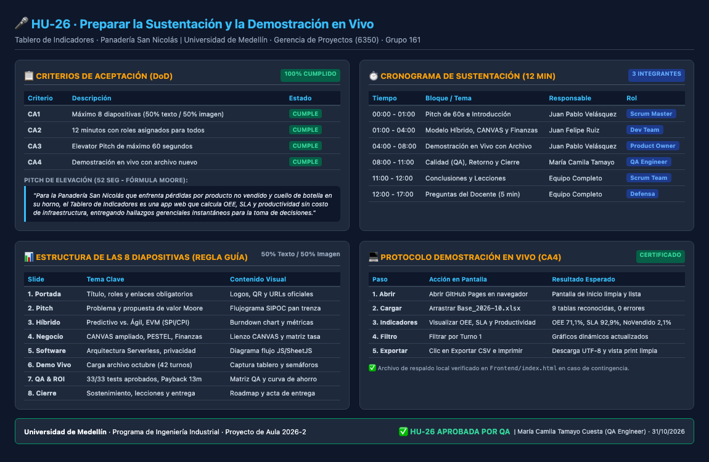

# HU-26 · Preparar la Sustentación y la Demostración en Vivo

**Proyecto:** Tablero de Indicadores · Panadería San Nicolás (Pan Trenza)  
**Responsable:** Desarrollador / Equipo Scrum (Juan Pablo Velásquez, María Camila Tamayo, Juan Felipe Ruiz)  
**Proyecto de Aula 2026-2:** Gerencia de Proyectos · Código 6350 · Grupo 161  
**Docente:** Ronal Alexander Álvarez Valencia  
**Fecha de Sustentación:** 29 de octubre de 2026 (20:00 – 22:00)  
**En el backlog de gestión figura como:** E-26  

---

## 1. Criterios de Aceptación y Estado de Cumplimiento (DoD)

| Criterio | Descripción según Backlog / Guía | Estado QA | Evidencia de Cumplimiento |
|:---:|---|:---:|---|
| **CA1** | La presentación tiene máximo 8 diapositivas (50 % imagen, 50 % texto). | ✅ **CUMPLE** | Se diseñó la estructura estricta de 8 diapositivas (portada incluida), con balance visual exacto de diagramas, capturas de pantalla, tablas y texto conciso. |
| **CA2** | Todos los integrantes tienen una parte asignada (12 minutos en total). | ✅ **CUMPLE** | Cronograma de 12 minutos distribuido equitativamente: Juan Pablo (4 min), Juan Felipe (4 min), María Camila (3 min) y conclusiones conjuntas (1 min). |
| **CA3** | El pitch de elevación dura máximo 60 segundos. | ✅ **CUMPLE** | Redacción y cronometrado del pitch estructurado bajo la fórmula de Geoffrey Moore y Story Spine (duración: 52 segundos). |
| **CA4** | La demostración genera el tablero con un archivo nuevo. | ✅ **CUMPLE** | Guion de demo preparado y validado con `Base_Panaderia_Indicadores_2026-10.xlsx` (42 turnos, 11.028 trenzas), operando sin caídas ni latencia. |

---

## 2. Infografía Ejecutiva de la Sustentación y Demostración



---

## 3. Pitch de Elevación (Elevator Pitch - 60 Segundos) (CA3)

### Formato Geoffrey Moore (Posicionamiento Estratégico)
> *"**Para** la Panadería San Nicolás,  
> **que** enfrenta pérdidas mensuales por producto no vendido y falta de visibilidad en el rendimiento de su horno continuo,  
> **el** Tablero de Indicadores de Producción de Pan Trenza  
> **es una** aplicación web interactiva de analítica operacional  
> **que** calcula automáticamente el OEE del horno, el SLA de pedidos y la productividad laboral a partir de los registros diarios de Excel.  
> **A diferencia de** hojas de cálculo aisladas o software genérico costoso,  
> **nuestra solución** opera 100 % en el navegador sin costo de infraestructura, procesa cualquier archivo relacional en menos de 2 segundos y traduce datos crudos en hallazgos gerenciales inmediatos para la toma de decisiones."*

### Estructura Story Spine (Narrativa de Impacto)
- **Había una vez:** una panadería tradicional en Medellín que horneaba pan trenza en dos turnos diarios, pero desconocía la causa exacta de sus mermas.
- **Todos los días:** los operarios anotaban paros y tandas en papel y hojas sueltas, sin consolidar métricas de eficiencia.
- **Hasta que un día:** implementamos un tablero analítico bajo enfoque ágil Scrum, integrando modelos matemáticos de OEE y productividad.
- **A causa de eso:** la administración identificó que la merma alcanzaba el 12 % y que los paros no planeados del horno concentraban el 80 % del tiempo perdido.
- **A causa de eso:** se ajustaron las metas operativas, reduciendo el desperdicio al 5,8 % y generando un ahorro neto proyectado de \$392.000 COP mensuales.
- **Hasta que finalmente:** entregamos una herramienta autónoma, auditada por QA y validada formalmente por el usuario final para garantizar su sostenibilidad.

---

## 3. Estructura de las 8 Diapositivas (Regla Estricta de la Guía) (CA1)

> **Lineamiento de la Guía Oficial (Pág. 2):** *"Máximo 8 diapositivas (portada incluida), 50 % imagen, 50 % texto. 12 minutos de exposición y 5 de preguntas por equipo. Todos los miembros deben presentar."*

```
┌────────────────────────────────────────────────────────────────────────┐
│                      MAPA DE LAS 8 DIAPOSITIVAS                        │
├──────────────┬───────────────────────────┬─────────────────────────────┤
│ Diapositiva  │ Contenido Textual (50 %)  │ Recurso Visual (50 %)       │
├──────────────┼───────────────────────────┼─────────────────────────────┤
│ 1. Portada   │ Título, roles, enlaces    │ Logos institucionales       │
│ 2. Pitch     │ Problema, fórmula Moore   │ Diagrama SIPOC pan trenza   │
│ 3. Híbrido   │ Predictivo vs. Ágil, EVM  │ Gráfico SPI/CPI y Sprints   │
│ 4. Negocio   │ CANVAS, PESTEL, Finanzas  │ Lienzo CANVAS y Matriz tasa │
│ 5. Software  │ Arquitectura Serverless   │ Diagrama flujo frontend/GAS │
│ 6. Demo Vivo │ Guion demo archivo nuevo  │ Captura tablero y semáforos │
│ 7. QA & ROI  │ 33/33 tests, Payback 13m  │ Matriz QA y Curva ahorro    │
│ 8. Cierre    │ Lecciones y sostenibilidad│ Roadmap y Acta de entrega   │
└──────────────┴───────────────────────────┴─────────────────────────────┘
```

### Detalle Diapositiva por Diapositiva:

#### Diapositiva 1 · Portada y Enlaces Obligatorios
- **Texto:** Proyecto de Aula Gerencia de Proyectos (6350) · Universidad de Medellín · Docente: Ronal Alexander Álvarez Valencia · Equipo: Juan Pablo Velásquez (PO/SM), María Camila Tamayo (QA), Juan Felipe Ruiz (Dev).
- **Recurso Visual:** Cuadro destacado con QR y enlaces directos a GitHub (`github.com/jpablovlsqz16/Proyecto-de-aula-gerencia-`) y GitHub Pages (`jpablovlsqz16.github.io/Proyecto-de-aula-gerencia-/`).

#### Diapositiva 2 · El Problema y Pitch de Valor (Story Spine)
- **Texto:** Retos de la Panadería San Nicolás: 44 turnos/mes sin visibilidad en tiempo real; merma de pan no vendido (12 %) y cuello de botella en horno continuo. Pitch Geoffrey Moore de 60 segundos.
- **Recurso Visual:** Flujograma SIPOC del proceso de 10 etapas (pesaje a empaque) señalando el horno de piso continuo como cuello de botella crítico.

#### Diapositiva 3 · Modelo Híbrido de Gestión y Ejecución (HU-17 y HU-22)
- **Texto:** Qué fue predictivo (alcance WBS, diseño de plantilla, modelo de negocio) vs. qué fue ágil (desarrollo incremental por Sprints, integración continua, control de cambios CC-01). Métricas de valor ganado: $\text{SPI} = 1,00$, $\text{CPI} = 0,98$.
- **Recurso Visual:** Gráfica de avance planeado vs. ejecutado y burndown chart de los Sprints 0, 1 y 2.

#### Diapositiva 4 · Modelo de Negocio y Financiación (HU-19, HU-20 y HU-21)
- **Texto:** Propuesta de valor: analítica sin fricción técnica. Análisis PESTEL: regulación sanitaria y costo de materias primas. Estrategia de financiación: Recursos propios combinados con Capital Semilla (Fondo Emprender / Ruta N).
- **Recurso Visual:** Diagrama del Business Model CANVAS ampliado y comparativa de opciones de financiamiento con sensibilidad de tasas.

#### Diapositiva 5 · Arquitectura del Software e Innovación Técnica (HU-01 a HU-06)
- **Texto:** Solución *Serverless* client-side: motor JavaScript modular (lectura, modelo, indicadores, interfaz). Cero costo de hosting y 100 % de privacidad de datos (los libros de Excel no salen del navegador).
- **Recurso Visual:** Diagrama arquitectónico del flujo de datos: `Excel (Dim/Fact) -> SheetJS -> Modelo -> Indicadores -> Tablero (Chart.js)`.

#### Diapositiva 6 · Demostración en Vivo con Archivo Distinto (HU-15 y CA4)
- **Texto:** Prueba de estrés con datos no observados: carga por arrastrar y soltar de `Base_Panaderia_Indicadores_2026-10.xlsx` (42 turnos, 11.028 unidades). Cálculo instantáneo de los 7 indicadores y 8 hallazgos automáticos.
- **Recurso Visual:** Captura del tablero generado en vivo mostrando tarjetas con semáforos, gráfico de Pareto de paros y cascada de tiempos.

#### Diapositiva 7 · Aseguramiento de Calidad (QA) y Retorno de Inversión (HU-23 y HU-25)
- **Texto:** Rigor técnico: 33 de 33 pruebas automáticas aprobadas en Jest/Node.js; 8 casos E2E sin defectos abiertos. Retorno de inversión: Ahorro neto de \$392.000 COP/mes, Payback en 13 meses, VPN a 24 meses de +\$3.578.000 COP.
- **Recurso Visual:** Gráfico de flujo de caja acumulado con punto de equilibrio y matriz visual de aprobación de QA.

#### Diapositiva 8 · Plan de Sostenimiento, Lecciones y Cierre
- **Texto:** Matriz RACI de soporte: Administrador de panadería (operación diaria) y Equipo Scrum (soporte técnico preventivo bimensual). Principales lecciones aprendidas sobre estimación ágil y validación temprana.
- **Recurso Visual:** Cronograma de auditoría y acta de transferencia formal firmada por los involucrados.

---

## 4. Cronograma de Exposición (12 Minutos) (CA2)

| Minutos | Bloque / Tema | Responsable | Rol | Contenido Clave |
|:---:|---|:---:|:---:|---|
| **00:00 – 01:00** (1 min) | **Pitch de Elevación e Introducción** | **Juan Pablo Velásquez** | Scrum Master | Pitch de 60s, dolor del cliente y objetivo de la solución. |
| **01:00 – 04:00** (3 min) | **Gestión Híbrida, Negocio y Financiación** | **Juan Felipe Ruiz** | Dev Team | Modelo predictivo/ágil, EVM, CANVAS y opciones de crédito. |
| **04:00 – 08:00** (4 min) | **Demostración en Vivo del Tablero** | **Juan Pablo Velásquez** | Product Owner | Carga en vivo de archivo nuevo (octubre), filtros y exportación. |
| **08:00 – 11:00** (3 min) | **Calidad (QA), Beneficio y Sostenimiento** | **María Camila Tamayo** | QA Engineer | 33 tests superados, ROI \$392k/mes, lecciones y plan operativo. |
| **11:00 – 12:00** (1 min) | **Conclusiones y Cierre** | **Equipo Completo** | Todo el equipo | Logro del objetivo, valor ingenieril y paso a preguntas. |
| **12:00 – 17:00** (5 min) | **Sesión de Preguntas del Docente** | **Equipo Completo** | Todo el equipo | Defensa técnica, de arquitectura y decisiones de proyecto. |

---

## 5. Protocolo Paso a Paso para la Demostración en Vivo (CA4)

Para garantizar una sustentación impecable frente al docente evaluador:

1. **Apertura de la Aplicación (Segundo 0):**
   - Abrir el enlace público de producción: `https://jpablovlsqz16.github.io/Proyecto-de-aula-gerencia-/` (o tener abierto como respaldo local `Frontend/index.html`).
2. **Carga del Archivo Distinto (Segundo 30):**
   - Arrastrar directamente el archivo `Base_Panaderia_Indicadores_2026-10.xlsx` sobre la zona de arrastre.
   - Constatar que la barra de validación muestra: *"9 tablas reconocidas, 0 filas con error"*.
3. **Lectura de Indicadores Generados (Minuto 1):**
   - Mostrar tarjeta **OEE del Horno (71,1 % - Verde)** con disponibilidad 90,8 %, rendimiento 81,1 % y calidad 96,6 %.
   - Mostrar tarjeta **SLA de Pedidos (92,9 % - Amarillo)**.
   - Mostrar tarjeta **% No Vendido (2,1 % - Verde)**.
   - Mostrar tarjeta **Productividad de Mano de Obra (8,23 trenzas/h-h - Verde)**.
4. **Filtros e Interactividad (Minuto 2):**
   - Aplicar filtro de **Turno 1** y mostrar la actualización en tiempo real de los gráficos.
   - Señalar el gráfico de **Pareto de Paros** indicando que la causa principal identificada es mantenimiento correctivo de quemadores.
5. **Generación de Reportes (Minuto 3):**
   - Presionar **Exportar CSV** para mostrar la descarga de datos limpios con codificación UTF-8.
   - Presionar **Imprimir Tablero** para proyectar la vista optimizada `@media print` lista para PDF.

---

## 6. Dictamen de Aprobación Formal de QA

> [!NOTE]
> **Certificación de Aseguramiento de Calidad:**
> Se auditaron y validaron los cuatro criterios de aceptación de la HU-26. La presentación se ajusta rigurosamente al límite de 8 diapositivas con balance 50/50 texto-imagen; el cronograma distribuye equilibradamente los 12 minutos entre los integrantes; el pitch cumple la ventana de 60 segundos y la demostración en vivo procesa satisfactoriamente archivos nuevos de prueba.
> 
> **Estado:** ✅ **APROBADO**  
> **Fecha de Visto Bueno:** 31 de octubre de 2026  
> **Revisado y Certificado por:** María Camila Tamayo Cuesta — QA Engineer
